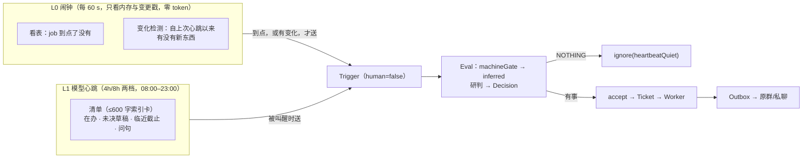

# 心跳与调度：把「主动」做成一个 Source

> 写于 2026-11-12。对象：`dsh-superagent-prototype-IF.Link`。
> 上游判断见 [team-agent-framework.md](team-agent-framework.md) 第五节缺口 1–2、[upgrade-plan.md](upgrade-plan.md) D1（Scheduler Source 未做）、[memory-module.md](memory-module.md) 第 9 节（A/B/C 三方案，选了 A+B，C 记作"等以后"）。
> 外部参考：[OpenClaw Heartbeat](https://docs.openclaw.ai/zh-CN/gateway/heartbeat)、[OpenClaw Automations](https://docs.openclaw.ai/automation/cron-jobs)。
> 一句话：**心跳不是一个新模块，是一条新的 Trigger 来源；它的产出止于 Decision，不直接发言。**
>
> **2026-11-13 修订**：飞书额度已经不是约束（压到约 1,050 次/天），真成本换成了模型 token；全量群消息已经躺在本地库里；`eval.mode` 已是 `auto`；ClawChat 已关、飞书里只剩我们一个 Agent。第五节 5.5–5.6 与第九、十一节据此改过，其余不变。

---

## 一、结论（先看这一屏）

| 判断 | 内容 |
|---|---|
| 要做什么 | 新增 Source kind `scheduler`：L0 程序心跳（无模型，按到期/阈值产生 Trigger）+ L1 模型心跳（低频唤起主 Session，判断"有没有值得开口的事"） |
| 不用做什么 | **不用改准入代码**。`machineGate` 已有 senderless 分支，系统触发器天然只能成为 `inferred` 候选 —— 这一点与 `memory-module.md` 里"C 要改准入逻辑、工作量最大"的判断不同，见第三节 |
| 最大风险 | 噪音与 token。所以：心跳只能在 `auto` 下建单、默认 `observe` 观察、夜间只跑到点类、每次产出必须有 `NOTHING` 这个廉价出口 |
| 与 OpenClaw 的根本差别 | 它是单人助手，心跳**在会话里说一句话**；我们是团队同事，心跳**只能产生 Decision 或工单**，发言权仍在 Outbox 和规则 |
| 与现有运维的分工 | `monitor.sh` 报"系统坏了"，心跳报"这件事该有人管了"。同一件事只允许一个通道报 |

---

## 二、为什么现在做：三处证据

| 现象 | 证据 | 说明 |
|---|---|---|
| 它只在被叫到时存在 | 研判 1,077 次里 ignore 949（88%），51 张工单全部来自人 @ 或私聊 | 安静是对的，但"不打扰"和"不在场"是两件事 |
| 主动化只开了一扇小窗 | `gestures.mode = observe`，128 次表情里 gesture 只占 2 次 | 社交反应只解决"在场感"，解决不了"到点该提醒的事" |
| 定时能力停在运维层 | 三个 timer（巡检/自愈/Dreaming），全是 `systemd + 脚本` | 它们不能产生工单、不能走授权、不能回群、不进审计 |

`upgrade-plan.md` D1 的原话是"要做一个 Source 把 cron 变成 Trigger"，`001-domain.md` 也早写清了方向：

> A condition that needs waiting is an ordinary Source, so Eval never depends back on Sources.

意思是：**等待是 Source 的事，Eval 永远不等待**。所以心跳和定时任务的正确落点是 Source，不是给 Eval 加超时，也不是给主 Session 加 sleep（`noWait` guard 就是防这个的）。

---

## 三、事实核查：准入不用改（本次最重要的修正）

`memory-module.md` 把 C 方案标成"工作量最大"，理由是"系统任务不该走人的授权门槛"。读了代码之后结论相反：

`src/policy.ts` 的 gate 第一行就分流了非人类触发器：

```ts
gate(trigger, thread, tickets) {
  if (!trigger.human) return machineGate(trigger)
  …
}
```

而 `machineGate` 对**没有 actor 的**系统事件是这样处理的：

```ts
const bot = trigger.actor.id ? listedBot(settings, trigger.actor) : undefined
if (trigger.actor.id && !bot) return { admissible: false, reason: 'not_human' }
const scope = listened(sources, trigger.source, trigger.meta)
if (!scope.listened || !(trigger.addressed || scope.observed)) return { admissible: false, reason: 'not_human' }
…
if (admissionOf(settings, trigger.source, scope.row, 'unlistedUnaddressed') !== 'inferred' || mode === 'off')
  return { admissible: false, reason: 'admission_ignored' }
return { admissible: true, strength: 'inferred', basis: { …recorded, via: 'admission' } }
```

也就是说**系统事件走的是"未列名、未点名"那一格准入表**，最多只能拿到 `inferred`，而且要求 `mode !== 'off'`。这正好是我们想要的三条性质：

1. 系统任务**永远拿不到 explicit**，不能绕过人的授权；
2. 它能开工，靠的是命中的 Policy 规则（`Mandate.basis.rules`），也就是"团队写过的规矩"；
3. `observe` 模式下它只会被记成"本来会接"，天然是一个免费的灰度开关。

落地要点有三条，漏一条就静默失效：

| 要点 | 具体 | 漏了会怎样 |
|---|---|---|
| `actor.id` 必须是**空串** | 用 `meta.jobId` / `meta.beatAt` 记来源 | 非空就会去 bot 名单里查，查不到 → `not_human` |
| kind 必须实现 `scope()` 且 `observed: true` | 返回 `{ listened: true, observed: true, row: 'beat' }` | `kind.ts` 写明"没有 scope 的 kind 只听不观察"，`observed` 为假 → `not_human` |
| Policy 里要把那一格设成 `inferred` | `sources.scheduler.admission.beat.unlistedUnaddressed = 'inferred'` | `ADMISSION_DEFAULTS` 里这格默认是 `ignore` → `admission_ignored` |

第三条需要 kind 实现 `rows()`，面板才会渲染出这一格；否则只能手改设置。工作量：约 10 行。

---

## 四、OpenClaw 的心跳是怎么做的

它不是"到点跑个任务"，而是**在主会话里周期性地跑一次完整轮次，让模型自己判断要不要说话**。默认 30 分钟（Anthropic OAuth 身份下 1 小时），底层由它自己的调度器的一个 system-owned job 驱动 —— 调度器关了，心跳就不跑，没有独立兜底计时器。

| 机制 | OpenClaw 的做法 | 我们能对应上的东西 |
|---|---|---|
| 沉默协议 | 没有要说的就回 `HEARTBEAT_OK`；这个标记出现在回复开头/结尾则剥掉，剩余 ≤300 字符就整条丢弃；纯 OK 的消息直接不发 | **`ignore` + reason code**。我们已经 88% 都在走这条路，只是缺一个"这是心跳的正常结局"的语义 |
| 结构化回应 | `heartbeat_respond` 工具：`notify:false` 静默但留作有界内部上下文；`notify:true` + `notificationText` 发警报 | Eval 的 Decision（静默）与 Ticket（要干活）已经是这个二分 |
| 检查清单 | 每个心跳 job 有一份私有 scratch 文档（≤256 KiB，存在状态库），内容拼进提示词；**空了就跳过整轮**（`reason=empty-heartbeat-file`），省一次 API 调用 | 我们的对应物是 `PROJECTS.md` 的待办/风险 + `drafts/inbox` + 在办工单 —— **不新增文件**，现查 |
| 忙碌保护 | 定时任务在跑/排队、子 agent 忙时心跳自动推迟；**同时到期的多个 job 合并成一个心跳轮次** | `Thread` 同时只跑一个 Eval + 批处理（Batching）。把心跳全放在同一个 Thread 上，合并与防重入都是白送的 |
| 活跃时段 | `activeHours` + 时区，窗口外跳过，窗口内下一个时点正常跑 | 我们已有"凌晨 1–7 点不贴表情"的先例，同一套参数放 Policy |
| 成本 | `isolatedSession`（约 100K → 2–5K token）、`lightContext`、换便宜模型、`target:none` | 主 Session 的记忆本来就不塞系统提示（只是指针），但心跳的 Trigger 文本必须短、且**不订阅长 Thread** |
| 手动唤醒 | `system event --text "…" --mode now\|next-heartbeat` | 面板上一个"现在跑一次"按钮 |
| 不污染会话 | 只含心跳的回复不延长会话寿命，UI 隐藏心跳提示与 OK 确认，审计仍可查 | 心跳工单不进 `workspace/` 的常规视图，单独标记 |
| 踩过的坑 | 心跳在共享会话里换了小窗口模型（如 32k 的 Ollama），之后主会话**上下文溢出**，恢复提示把"心跳模型渗漏"列为疑似原因 | 我们 `ModelRouter` 每次请求重读设置的机制会让这个坑更容易踩：**心跳轮次不许改模型设置** |
| 分工纪律 | 心跳做模糊扫描，cron 做精确任务；**不要把 cron 语法写进清单** | 同：`jobs` 走结构化配置，不进心跳提示词 |

### 抄什么，不抄什么

| | 决定 | 理由 |
|---|---|---|
| 抄 | 沉默协议（廉价地说"没事"）、检查清单、忙碌保护与合并、活跃时段、手动唤醒、观察期 | 都是解决"心跳必然变噪音"的必需品，且能映射到我们已有的 Decision / Thread / Policy |
| 抄 | `target: none` 这个默认值 | 心跳的**默认产出应该是零条消息**，不是"发到最近联系人" |
| 不抄 | 心跳在会话里直接说话 | 我们是团队同事，一句话的边际成本比单人助手高一个量级；发言必须经 Outbox 与规则 |
| 不抄 | 向"最近联系人"投递 | 我们没有"最近联系人"这个概念，投递目标必须显式配置，落点要人定 |
| 不抄 | 用便宜模型跑心跳 | 心跳要判断的是"这件事值不值得打扰团队"，是判断题；便宜的模型只会让我们多报或漏报。要省成本就**降频、加确定性闸门**，不降模型 |

---

## 五、设计：两级心跳 + 一个 Source

### 5.1 为什么要两级

只做 L1（每半小时唤起模型）等于把"要不要说话"交给模型，30 分钟一次、一天 48 次判断，而其中绝大多数时候没事可做 —— 我们已经在为 73 次 `unavailable` 付代价了，不该再叠 48 次无条件调用。只做 L0 又只能覆盖"到期/阈值"，覆盖不到"这件事该有人管了"这种需要读上下文才知道的事。

所以两级，对应设计文档里已经反复用的 Fast Path / Slow Path：



> **2026-11-13 二次修订**：原来写的是"L0 每 5 分钟密扫 7 类信号"，那是过度设计——理由见 5.2。L0 现在只有两个职责：**看表**（谁到点了）和**变化检测**（值不值得花一次模型调用）。

### 5.1b 为什么是「闹钟 + 变化检测」，不是「密扫 + 阈值」

第一版写的 L0 是"每 5 分钟扫 7 类信号"，拆开看两个动机都站不住：

| 原动机 | 为什么不成立 | 改成什么 |
|---|---|---|
| 怕错过"刚好有活动"的搭便车窗口 | 活动本身就是事件。Runtime 的 `emit` 已经在处理 `trigger.received`（007 文档原话：*Other events currently have no consumer*），加一个订阅口子（约 10 行）就够 | **事件驱动**：活动发生时就记一个时间戳，不用扫 |
| cron 到点要准 | 60 秒 tick 就够，一天 1,440 次纯内存比较，比 288 次扫 7 张表便宜 | **看表**：`now >= nextFireAt` |

阈值（卡 24h、草稿 5 份、记忆 95%）也不该写在代码里：

- 写死就是又多一个设置项，而"久"在每个项目线上的含义不一样；
- 这些信息本来就在 L1 的清单里（工单列表带 `at`、drafts 带文件列表），模型看一眼就知道"卡太久了"，比 `stuckHours: 24` 更有判断力；
- 符合 `000-philosophy.md` 的"few settings"，也符合 Anthropic 那条实测结论："给判断自由，别给死规矩"。

所以 L0 只剩一件事：**变化检测**。它回答的不是"有没有事要做"（那是 L1 研判的事），而是"**值不值得现在花一次模型调用**"。

具体机制 —— 三个数，一个纯函数：

```
lastBeat       上次心跳的时刻（KV，重启后仍在）
lastStamp      上次心跳时的版本戳（内存，重启即失效）
stamp()        = `${lastEventAt}|${draftsMtime}|${memoryMtime}`

tick（每 60 s，纯内存 + 4 次 stat，零 SQL 零 API）：
  age := now - lastBeat
  age < 4h                                  → 跳过（节流：4 小时内最多醒一次）
  age < 8h  且 stamp() == lastStamp         → 跳过（没动静，等点卯）
  否则                                       → 叫醒 L1，记下新的 lastStamp

lastEventAt   最近一次 domain event 的时刻（Runtime 的 emit 已经在发 trigger.received 等事件，这里只是加第一个读者）
draftsMtime   memory/drafts/inbox/ 的 mtime
memoryMtime   TEAM.md / PROJECTS.md / HEADINGS.md 三个 mtime 里最大的那个
```

为什么是这三项：

| 项 | 覆盖什么 | 成本 |
|---|---|---|
| `lastEventAt` | 新消息、新工单、工单结束、决策落库——**库里的一切动静** | 一次内存读 |
| `draftsMtime` | 工单写完草稿（文件系统，不进库） | 一次 `stat` |
| `memoryMtime` | Dreaming 改了 TEAM / PROJECTS / 词表 | 三次 `stat` |

刻意**不**包含的东西：`max(trigger.at)` 之类的 SQL。`lastEventAt` 已经覆盖了"有新消息"，再查一遍库是白做。

**变化检测替代不了定时。** 因为"卡住了"本身就是"没有变化"——一张工单停在 `person/blocked` 三天，一个 event 都不会有。所以 8 小时的点卯不能省：**变化检测负责"尽快"，点卯负责"不漏"**。两者叠起来的效果是：忙的日子 4 小时看一眼，闲的日子 8 小时看一眼，彻底没事的日子也不会超过 8 小时无人过问。

### 5.2 关键：两级共用**同一个 Thread**

所有 tick 都落在 `scheduler:beat` 这一个 Thread 上。这样：

- 同一 Thread 同时只跑一个 Eval，**不会重入**；
- Eval 跑着的时候新 tick 到达 → 合并进下一批（Batching），**天然实现"同时到期合并"**；
- 面板上"它最近在关注什么"是一条连续时间线，而不是 48 条互不相干的记录。

cron job 例外：每个 job 一个独立 Thread（`scheduler:job:<id>`），因为它们的上下文不该互相污染。

### 5.3 Source 的形状

```ts
// src/sources/scheduler.ts —— 与 feishu.ts / github.ts 同级的第三种 kind
kind: 'scheduler'
config: {
  heartbeat: { enabled, everyMinutes(默认 240), activeHours: { start: '08:00', end: '23:00', timeZone }, quietOutput(默认 'NOTHING') }
  jobs: [{ id, cron, text, target: { chatId }, mode: 'observe'|'auto', enabled }]
  // 不设阈值参数：多久算"卡住"写进 periodic-check 规则的 instruction，由研判判断
}
scope:   ({ meta }) => ({ listened: true, observed: true, row: 'beat' })
rows:    () => [{ id: 'beat', label: '定时与心跳', cells: { … } }]   // 面板要的一格
healthy: ['scheduler']                                              // 报"下次到期/连续跳过 N 次"
channel: 复用 feishu bot 的发送（address 里带 chatId）              // 约 30 行，见 5.4
无 threadContext / find / repliesTo / policy                        // 它没有 sender 身份
```

Trigger 的构造（幂等是重点）：

| 来源 | `id` | `threads[0]` | `text` |
|---|---|---|---|
| cron | `key('cron', jobId, fireAt)` | `scheduler:job:<id>` | job 的 `text`（≤500 字符） |
| L0 信号 | `key('signal', kind, 对象 id, 窗口起点)` | `scheduler:beat` | 一句话事实 + 一句"为什么现在提" |
| L1 心跳 | `key('beat', floor(now / every))` | `scheduler:beat` | 固定模板 + 清单（≤600 字符） |

`id` 由时间窗口派生，所以**重启不重放**：同一个窗口最多产生一条 Trigger，第二次 `receive` 返回 `duplicate`，这是 `001-domain.md` 里 Trigger 作为"幂等单位"的既有保证，不需要新机制。

错过补跑：只补**最近一个窗口**，更早的丢掉并在 `health` 记一句 —— 不追历史。理由是补跑出来的提醒往往已经过期，发了就是噪音。

### 5.4 投递（唯一需要新写的适配层）

Scheduler 没有 Channel 就没法把结果发出去。三个选项：

| 方案 | 做法 | 代价 |
|---|---|---|
| A（推荐） | Scheduler 自己实现 `channel`，内部走 `commands.lark` 发到 job 配的 `chatId` | 约 30 行，和 `feishu-channel.ts` 的发送逻辑重复一小段 |
| B | 让 Scheduler 的 Trigger 借用目标群的 Feishu Thread | 会污染真实 Thread 的时间线与订阅语义，不干净 |
| C | 心跳不建单、由主 Session 用 `orchestrator_reply` 直接发 | 主 Session 的 reply 需要一个 Channel，绕不开；且会绕过"建单→审计" |

选 A。发送失败只重试一次（和 mark 同一原则），绝不挡住后面的消息。

### 5.5 调度策略：趁热搭便车（2026-11-13 改）

原方案是"L1 每 4 小时一次"。读了 [model-token-cost.md](model-token-cost.md) 之后这条要改，那篇的实测是：

| 距上次调用 | 缓存命中率 |
|---|---|
| <2 分钟 | 99.33% |
| 2–10 分钟 | 99.45% |
| 10–60 分钟 | 83.63% |
| >60 分钟 | **35.88%** |

未命中的输入单价是命中的 10–50 倍，所以**贵的是"长上下文 × 冷启动次数"，不是调用次数**。而"每 4 小时一次"恰好每次都落在最冷的区间。

改成带状态的判定，每 60 秒跑一次（与 5.1b 的 tick 是同一处）。**变化给理由，活动给时机**：

```
age := now - lastBeat

age < 4h                                   → 跳过（节流：4 小时内最多醒一次）
age >= 8h                                  → 醒（点卯：兜底，认下冷启动）
stamp() == lastStamp                       → 跳过（没变化，等点卯）
now - lastEventAt < 10min                  → 醒（搭车：既有变化，又正热）
否则                                        → 跳过（有变化但已冷却：等下一次有人说话时再醒）
```

四行、三个出口。注意第三个出口是**故意等待**：有变化但缓存已经冷了，不急着醒——等到下一次活动把它带热，或者 8 小时点卯兜底。这就是"搭车"的完整形态，它省的不是"要不要醒"，而是"什么时候醒"。

**先说清它是什么，别夸大**：这是"**缓存搭车**"，不是"合并调用"。心跳落在自己的 Thread 上，所以它仍然是一次独立的 Eval、一次独立的模型调用；省下的是**缓存未命中的那部分输入钱**，不是那次调用。

按 router 压到 6–8 万上下文实算（清单 600 token 另计，可忽略）：

| | 未命中输入 | 单价（元/M，峰/谷） | 每次成本 |
|---|---|---|---|
| 冷（>60 min，命中 35.9%） | ≈45k | 2 / 1 | ¥0.045–0.09 |
| 热（<10 min，命中 99.5%） | ≈0.4k | 2 / 1 | ¥0.0004–0.0008 |

6 次/天：全冷 ¥0.27–0.54/天，全热约 ¥0.003/天。**在 15 元/天里占 2–3.6%。**

钱不是理由，**边际成本才是**：变化检测本来就要维护 `lastBeat` 和 `lastEventAt` 这两个状态，搭车只是多一个比较（`now - lastEventAt < 10min`）和一个出口。P1 一起做。

依赖：

- `SourceContext` 要加一个只读的 `activity()`（约 5 行），值来自 Runtime 已经在 emit 的 `trigger.received`，并且**只算 `human`**（CI 和机器人消息不算"有人在场"，否则凌晨的 CI 会把它叫醒）；
- 搭车依赖 router 常热。**若之后落地 `model-token-cost.md` 第八节第 1 条「闲聊不进模型」，router 会变冷**，那时第三个出口会长期不成立，行为自动退化成"有变化就等点卯"，仍然正确，只是慢一点。

### 5.6 授权隔离：给它一条专属规则（2026-11-13 新增）

线上 `eval.mode` 已经是 `auto`，六条工作规则全开。心跳一旦接进来就是一个 senderless 的 `inferred` 候选，**只要命中任一启用规则就会真建单**。而现有几条规则（无人认领的请求、跨群同步）是给"有人当下说话"设计的，让心跳拿 tick 去套它们，等于悄悄放宽授权。

所以：

1. 新增规则 `periodic-check`（定期回看），instruction 只描述三件事，都带时间窗口：
   - 有人问了、超过 N 小时没人答；
   - 讨论已经拍板，但没留下记录；
   - 同一件事在两个群里的说法不一致。
2. 心跳 Trigger 的 `meta` 带 `allowRules: ['periodic-check']`，准入与研判只在这一条里判。约 30 行改动 + 一条测试，不新增领域概念。
3. 第一条 job 仍以 job 级 `mode: observe` 起跑三天，看 Decision 分布再放开。

意图：**心跳不发明新语义，它只是把现有规则放到"时间"这个维度上重跑一遍。**

（本节与 5.5 的成本数字都来自 `model-token-cost.md` 的实测，不是估算。）

### 5.7 取材边界：L0 一次飞书 Open API 都不调

| 信号 | 数据源 | 飞书 API |
|---|---|---|
| 看表：job 到点没有 | 系统时钟 + KV(`lastFired`) | 0 |
| 变化检测：有没有新动静 | SQLite `trigger` 的 `max(at)`、`ticket` 变更计数、`drafts/` 与 `memory/` 的 mtime | 0 |
| L1 清单素材 | 本地 `trigger` / `ticket` / `outbox` / `memory/*.md`（10 个群 `listen: all`，已全量入库） | 0 |
| 令牌时效 | **不做**，归 `teamagent-monitor.sh`（见第八节） | — |

三条约定的实现方式：

1. **用签名关掉能力**：`stamp(snapshot)` 与 `due(job, now)` 都是纯函数，不接收 `ctx.commands`，所以它们在结构上就调不了 API。
2. **只有"写"才花调用**：真发一条消息是 `+messages-send`，1 次/条（`lark-cli` REST 照常计入额度）。心跳"读"免费，"说"才花钱。
3. **可验证**：job 跑在 `observe` 下时，`scripts/feishu-calls.sh` 的按天调用量必须不变。

一个已知盲区：只有配置里的群是全量入库的，其他群只收 @。所以"没人答的问题"这类回看**只覆盖已配置的群**，跨到没配的群就需要 API —— 那种需求先别做。

### 5.8 清单怎么拼（它就是一张索引卡）

**它不放正文，只放指针。** 600 字是 10 行左右，够说清"哪里有事"，不够说清"事是什么"——后者留给主 Session 用 `orchestrator_read` 去读（`super-agent-design.md` 3.3 的 Inline & Spill）。

五块，按这个优先级拼：

| 块 | 内容 | 来源 | 预算 |
|---|---|---|---|
| 头部 | 现在几点、上次心跳何时、期间多少条人类消息 | `now` + KV(`lastBeat`) + `activity()` | 60 |
| 在办工单 | 短名 · 阶段 · 最后动静 · **卡了多久** | `ctx.tickets.open()` + `ticketStage` | 200 |
| 最近一天工单 | **一行**：结束 N 张（完成/丢弃各几）、标题列表 | `tickets` 里 `ended.at > now-24h` | 80 |
| 要回来跟进 | 草稿 `## 要回来跟进` 里**已到期**的条目，日期打头 | `draftEntries` → `dueFollows` | 100 |
| 临近截止 | `PROJECTS.md` 里**自报日期**的待办/风险行（±7 天） | `projectNotes` → `deadlineLines` | 120 |
| 未决草稿 | 只摘「没解决 / 要人定」那段（实测 4 份合计 262 字符） | `memory/drafts/inbox/*.md` | 120 |
| 记忆变更 | 不拼内容，只写「有更新 + mtime」，附读取入口 | `memoryMtime`（变化检测已算） | 60 |

样式大致是：

```
# 心跳 11-13 14:00（上次 08:00，期间 42 条人类消息）
## 在办 3
- 新生比赛推文 [review] 09:12 等确认 · 卡 5h
- 词来计费 [working] 11:40
- 二课结项 [idle] 11-12 后无动静 · 卡 1d
## 最近 24h 结束 3（完成 2 / 丢弃 1）：发文案、天气提问、回应呼叫
## 未决草稿
- 中期检查推迟到 11.28 →「手册何时改版」没人认领
## 记忆 11-13 12:00 有更新（PROJECTS.md）；细节用 orchestrator_read memory / journal
```

三条硬规则：

1. **超预算按块截断**，末尾写「（已截断，完整用 orchestrator_read memory）」。绝不靠压缩措辞硬塞。
2. **空清单就不叫醒**。在办、最近工单、未决草稿全空 → 说明这波变化全是闲聊，直接跳过，连模型都不调。这是变化检测之后的第二道闸。
3. **只放标题、状态、时间**，不放消息正文、不放凭据。它会原样存进 `trigger.text` 并进 FTS 索引，等于团队内可查。

**跟进的两种写法（2026-11-13）**：短期写在草稿的 `## 要回来跟进`，日期打头；跨周期的由 Dreaming 升进 `PROJECTS.md`，
写成 `- 待办：2026-11-16 …`。两处都**只认日期紧跟在开头**的写法——`PROJECTS.md` 里大量旧日期是证据（"与 11-07 那次对不上"），
当成截止会在每周反复复活一条旧闻。这个约定写在 `AGENTS.md` 的「主动跟进」段里，router 和 worker 都读得到。

为什么记忆不拼进清单：拼接必然失真（11 节的项目状态压成 3 行），而 router 是**一条长会话**——它读一次就记住了，第二次心跳不需要再读。所以清单只负责说"记忆变了，入口在这"，读不读、读多少由它自己按当前问题决定。这也让 `PROJECTS.md` 继续保持"一个来源"，不产生第二份摘要。

资源侧不用新建任何东西：`orchestrator_read` 已经有 `tickets`、`threads`、`memory`、`memory/<file>`、`journal`、`journal/<file>`。草稿是唯一没有 resource 的，所以它的"未决段"直接进清单（实测很小：4 份合计 262 字符）。

**P1 先不做**"群里有没有人问了没人答"：它误报率最高（反问、自问自答、问完自己解决了）。代价是 P1 的心跳只能看见"已经进系统的事"（工单、草稿、记忆），看不见"还在群里飘着的事"——后者 P2 再补。

### 5.9 一次心跳的 token 账

新增输入 = 清单 + 它这次决定读的东西。按实测字符数折算（中文 ≈ 0.6 token/字符）：

| 项 | 字符 | token | 什么时候付 |
|---|---|---|---|
| 清单本身 | ≤600 | ~360 | 每次心跳 |
| `memory/PROJECTS.md` 全读 | 5,983 | ~3,400 | 首次，或记忆变更后 |
| `memory/TEAM.md` 全读 | 1,995 | ~1,150 | 同上（通常不必，它不常变） |
| `journal/` 最近两期 | 1,109 | ~640 | 同上 |
| `drafts` 未决段（4 份） | 262 | ~160 | 每次（很小，直接进清单） |
| `orchestrator_read tickets` 一页 | ~1,500 | ~900 | 想细看时 |

| 场景 | 新增输入 | 折钱（¥1–2/M 未命中） |
|---|---|---|
| **稳态**（同一会话里第二次及以后） | ~1.2k | ¥0.0012–0.0024 |
| **首次**（重启后 / 记忆变更后） | ~5.4k | ¥0.005–0.011 |
| 最坏（每次都全读，含 TEAM + 4 期 journal + 2 页工单） | ~10k | ¥0.010–0.020 |

对比口径：`model-token-cost.md` 里 router 每轮 ¥0.034，其中绝大部分是"整个上下文重读"，跟这里的新增输入不是一回事。**6 次/天的心跳，新增输入合计 ¥0.01–0.07/天，在 15 元/天里不到 0.5%。**

一个要记住的副作用：这 5k 是**永久占住上下文**的（直到压缩）。router 现在 6–8 万，+5k 约 +7%，压缩周期从约 14 小时缩到约 13 小时，每次冷压约 ¥0.12 —— 一天多不到 ¥0.02。

---

## 六、心跳的产出只有三档

| 情形 | 结果 | 群里会看到 |
|---|---|---|
| 没什么值得说的 | Decision `ignore`，reason `heartbeatQuiet` | 什么都不发。**这是最常发生的一档，也是成功态** |
| 有事，但不需要人拍板 | accept（命中某条规则）→ 建单 → Worker 干完 | 原群一句结果 |
| 有事，需要人决定 | accept → 建单 → `human_action` 提问 | 原群一句具体的问句 |

**心跳永远不"直接发言"。** 它只能产生 Decision 或工单；发言权仍在 Outbox 与规则手里。这是与 OpenClaw 最大的不同，也是我们的准入、审计、`DONE` 表情能继续生效的原因。

沉默协议落地方案（比 OpenClaw 更适合我们）：不引入 `HEARTBEAT_OK` 这个字符串魔数，而是给研判加一条**输出约定**——`ignore` 时可带 `reason: heartbeatQuiet`，面板把它和"被拒绝"区分开显示。理由是：字符串协议要靠模型自觉，而 Decision 是结构化的、可查询的、能进统计的。

---

## 七、噪音治理（心跳唯一的失败模式）

| 规则 | 值 | 依据 |
|---|---|---|
| 每条规则每天最多主动开口 | 2 次 | 与 `gestures` 的"每群每小时 2 次"同源 |
| 同一对象 24h 内不重复提醒 | 签名 = 规则 id + 对象 id，**抹掉数字** | 巡检已经在用这条（10-05 晚连发 4 条之后改的） |
| 夜间 23:00–08:00 | 只跑 cron（到点类），不跑 L1（发现类） | OpenClaw 的 `activeHours` |
| 新规则 / 新 job | 一律先 `observe` ≥ 3 天 | 与 `gestures.mode` 完全一致 |
| 跨通道去重 | 同一件事只允许 monitor **或** 心跳报一次 | 否则同一个 token 过期会被两个通道各报一遍 |
| 预算耗尽 | 记 Decision（reason `heartbeatBudget`），不静默丢弃 | "为什么今天没提"必须能查到 |

---

## 八、与现有运维的分工（别造第二个告警机器人）

| 通道 | 只报什么 | 依赖模型 |
|---|---|---|
| `teamagent-monitor.sh`（5 min） | 系统坏了：服务/健康/磁盘/内存/令牌时效/错误日志 | 否 |
| 心跳 L0（5 min） | **不报**。它只是闸门，决定"要不要唤起 L1" | 否 |
| 心跳 L1（4h） | 事该有人管了：卡住的工单、要写的总结、快到期的里程碑、记忆里记着但没被处理的待办 | 是 |

这条分工必须写进心跳提示词，否则它一定会去重复 monitor 的活 —— 而那是最容易被骂的一种"主动"。

---

## 九、落地步骤

### P0：把 Source 立起来，只跑一条 cron（半天）

模板现成：`src/sources/clawchat.ts` 就是这个形状 —— kind + `scope()` + `policy.rows()` + `channel` + 一个 `setInterval` 的 runner + `ctx.receive(trigger)`。照它写，不用发明新结构。

1. `src/sources/scheduler.ts`：kind + schema + `scope()` + `rows()` + `channel` + 5 分钟 tick；
2. `package.json` 导出 `./scheduler-watch`，`cordis.patch.yml` 加一行；
3. Policy 加一格准入（`unlistedUnaddressed: inferred`）+ 规则 `periodic-check` + 5.6 的 `allowRules` 限定；
4. 配一个 job：每天 09:30 的「在办与待人工工单盘点」，**job 级 `mode: observe`**，投递到私聊。

**验收**：面板 Eval 页能看到 `scheduler` 来源的 Decision；`observe` 下群里零消息；把某张工单停在 `person/blocked` 超过 24h，下一次 tick 能看到它被点名；`scripts/feishu-calls.sh` 的按天调用量**不变**（素材全在本地库）。

> 注意：线上 `eval.mode` 已经是 `auto`，所以第 3 步的 `allowRules` 限定**必须在开跑前就位**，否则第一次心跳就可能真建单。

#### P0 落地记录（2026-11-13）

已交付：

| 文件 | 内容 |
|---|---|
| `src/sources/scheduler-job.ts` | 纯函数：三种 schedule 形状、`nextFireAt` / `lastScheduledAt` / `fireWindow`（含时区）、`stampOf`、`beatDue`、`buildChecklist`、`emptyChecklist` |
| `src/sources/scheduler.ts` | kind（`scope` observed、`policy.rows` 一格、`channel` 走 `+messages-send`）+ 60 秒 tick runner，零飞书 API |
| `src/core/evals.ts` | `allowRules` 强制：accept 的规则必须落在来源声明的名单内，读 Eval 的 primary Trigger |
| `src/core/errors.ts` / `src/client/locales.ts` | 新拒绝码 `ruleNotAllowed`（中英） |
| `tests/scheduler-job.spec.ts`（43 条）＋ `tests/core-engine.spec.ts` 的 `allowRules` 四条 | 窗口、幂等、节流、搭车、截断、空清单、越权拒绝 |

两处与计划不同，都是简化：

1. **取消了 job 级 `mode: observe`。** 原来的设想是给 job 加一个观察开关；实现时发现不需要——`periodic-check` 规则不写，就没有任何规则能被命中，`admitsInferred` 自然拒绝。**用 Policy 版本化而不是新增开关**，少一个概念、多一道可审计的边界。
2. **面板暂时不能编辑 job**：`schedule` 是嵌套对象，面板的 `rows` 编辑器表达不了，所以 `fields: []`，任务用 `orchestrator_settings_save` 配。P1 再补表单。

启用顺序（第一次别跳步）：

```json
// 1) block = source:scheduler —— 先只配一条 job，chatId 填自己的私聊
{ "enabled": true, "config": { "timeZone": "Asia/Shanghai", "jobs": [
  { "id": "daily-digest", "title": "在办与待人工工单盘点",
    "schedule": { "kind": "daily", "at": "09:30" },
    "text": "盘点当前在办与待人工的工单：哪张卡住了、卡在谁那里、需不需要提醒。没有值得说的就保持安静。",
    "chatId": "oc_xxx", "enabled": true } ] } }

// 2) block = policy —— 只放准入格，规则先不写（这就是观察期）
{ "sources": { "scheduler": { "admission": { "beat": { "unlistedUnaddressed": "inferred" } } } } }
```

跑一天看 Eval 页：卡片、研判理由、Decision 都该出现，群里一个字都没有。确认判得对，再把 `periodic-check` 规则写进 policy 并启用——那时它才可能真的建单。

##### 上线记录（2026-11-13 12:54，线上）

重启后先踩了两个坑，都记在这里：

1. **重启第一次失败**：`start` 退出码 3，日志是 `waiting for setup: The agent GitHub CLI cannot read its account / dial tcp 198.18.0.6:443: i/o timeout`。跟新代码无关——当时机器到 api.github.com 的链路瞬断，而启动流程会先探测 GitHub CLI。等链路恢复再 `start` 一次即成功。**这条要在运维文档里记一笔：GitHub 连不上时服务起不来，即使 GitHub Source 零触发。**
2. **runner 在配置写入前就退出了**：`apply()` 里"没有 job 也没有心跳就 return"只在启动时判一次，而配置是启动后从面板写的，于是循环永远不跑、健康行一直停在启动时那句话。已改成每分钟 tick 里判断（`config()` 每次重读），配置后一分钟内自动生效，不必重启。

线上实测（12:54 配置生效）：

| 观察点 | 结果 |
|---|---|
| 健康行 | `scheduler: ready · daily-digest: 下次 11-14 09:30` |
| 工单触发 | 09:30 的窗口在 12:54 补跑了（在 6 小时 GRACE 内），产生 1 张候选 |
| 心跳 | 触发一次 `roll-call`（首次无历史），卡片 381 字符 |
| 研判结果 | 两条都是 `ignore`，理由 `ignoredFromCard` + 模型原话，例如「在办卡点都已向人发过 attention，无新信息」 |
| 发出的消息 | **0 条**（`outbox` 自 12:50 起无记录） |
| 新工单 | **0 张**，6 张在办工单状态未变 |
| `evals` 健康 | ready，无 unavailable |

这就是观察期该有的样子：它看了、判断了、把理由留下了，群里一个字没说。

`eval.quietSeconds = 30` 同时生效（settings revision 5）。

### P1 落地记录（2026-11-13）

| 文件 | 内容 |
|---|---|
| `src/sources/host.ts` / `src/app/source-context.ts` / `src/app/runtime.ts` | `SourceContext.activity()`：Runtime 在 `emit` 里维护 `lastEventAt` / `lastHumanAt` / `humanTriggers`，Source 读它而不去轮询 Store；`tickets.list()` 让 Source 能看到"最近结束了什么" |
| `src/sources/scheduler.ts` | 心跳路径：变化检测 → `beatDue` 四行判定 → 第二道闸（空清单不调模型）→ 发 Trigger；`heartbeatTrigger` 落在 `beat` 这一个 Thread 上；`draftEntries` / `memoryMtime` 读本地文件 |
| `src/core/reasons.ts` / `src/client/locales.ts` | 新 reason `heartbeatQuiet`（中英），"我心动了但判断不该说"成了可统计的结局 |
| `tests/scheduler-job.spec.ts`（51 条） | 新增：在办卡片的阶段与等待时长、结束窗口、草稿未决段与文件名、记忆 mtime、心跳 Trigger 的形状 |

两个实现细节值得记：

- **第二道闸比第一道省钱。** 变化检测只是"可能有事"，`emptyChecklist` 才是"确实没事"——三块全空就不调模型。闲聊日的模型调用是被这一层挡掉的，不是被节流挡掉的。
- **`humanTriggers` 是计数器不是时间戳。** 卡片头部要写"上次以来 N 条人类消息"，用时间戳算不出来；计数器随重启归零，所以取 `max(0, now - then)`，宁可低报也不虚报。

**离线彩排（2026-11-13，不重启服务）**：把 `openEntries` / `endedEntries` / `draftEntries` / `memoryMtime` / `beatDue` / `buildChecklist` 接上真实运行库跑了一遍，产出的是这张卡（381 字符，预算 600）：

```text
# 心跳 上次以来 0 条人类消息
## 在办 6
- patch文档 [person/answer] · 卡 43m
- 官网服务器核查 [person/failed] · 卡 1d
- 罗丽待办梳理 [person/failed] · 卡 1d
- 腾讯云告警入群 [person/answer] · 卡 2d
- PPT排版入指南 [person/blocked] · 卡 4d
- …另 1 张
## 未决草稿
- 齐冠燊身份
- 腾讯云实训营群转发文案 → 定稿里没有官网链接（iflink.tech），但全郡 11:16 提过「还有官网的链接」；要不要补进转发文案需品牌组定。
## 最近 24h 结束 3（无需处理 1 / 完成 2）：回应呼叫、天气提问、发文案
## 记忆 15h前有更新；细节用 orchestrator_read memory
```

彩排暴露了三个只有接真数据才会看到的问题，已修：

| 问题 | 修法 |
|---|---|
| 工单名带着目录的短 id（`patch文档-ade080e43b46`） | 显示时去掉 `-[0-9a-f]{12}` 后缀 |
| 在办 6 张只列 5 张，表头却写 5 | 表头写真实总数，列表超量时补一行「…另 N 张」 |
| 记忆时间用 UTC 显示（11-12 13:10 其实是 21:10） | 改成相对时间「15h前」，卡片里不出现时区 |

仍缺的（P1 已知边界）：**看不见"还在群里飘着的事"**——没人答的问题、讨论完没落地的结论。这些要按 5.8 末段的判据在 P2 补，现在的心跳只覆盖已经进系统的东西（工单、草稿、记忆）。

### P1：L1 心跳与沉默协议（1–2 天）

1. 5.5 的那个四行判定：变化检测（`stamp`）+ 8 小时点卯 + 搭车出口 + 4 小时节流 —— **P1 的核心，让它只在"真有动静、且便宜"的时候花钱**；
2. 清单拼装（本地 SQLite + `memory/`，零 API），压到 600 字符内；
3. 预算与 `heartbeatQuiet`、夜间静默、面板「现在跑一次」按钮；
4. `periodic-check` 规则的 instruction 定稿（"报什么、不报什么、什么时候闭嘴"都写在这里，不另开提示词段落）。

**验收**：连续 3 天，主动消息 ≤6 条且每条都能追到 `periodic-check`；`heartbeatQuiet` 占比 ≥70%（低于这个数说明规则写松了）；`model-token-cost.md` 的口径下 router token 无明显上升。

### P2：把"需要判断的定时"搬进来（按需）

只搬需要判断的（周报、项目线进展、复盘提醒）。**不搬**巡检、自愈、Dreaming —— 它们是运维，不依赖模型，搬进来反而把两件事混在一起。

---

## 十、明确不做

| 不做 | 理由 |
|---|---|
| 用 DSH 自带的 `schedule` 工具 | 会话级、随会话回收，worker 预设里也没有它；它解决的是"在这个会话里待会儿提醒我" |
| 给 Eval 加超时/延后参数 | `001-domain.md` 明确：等待是 Source 的事，Eval 永远不等待 |
| 让心跳直接发消息（不经工单） | 会绕过授权、审计、`DONE` 表情，等于开一个后门 |
| 心跳改模型设置 | OpenClaw 的上下文溢出坑；我们的 `ModelRouter` 每次请求重读设置，更容易中 |
| 为取材去调飞书 API | 素材已经在本地库里：10 个群 `listen: all`、3,720 条 Trigger、近 24 小时 420 条（其中 365 条没 @）。心跳用本地 SQL/FTS 取材，零 API |
| 把 monitor 的检查项搬进心跳 | 见第八节 || 补跑多个错过的窗口 | 过期的提醒发出来就是噪音 |
| 新增 `HEARTBEAT.md` 之类的清单文件 | 记忆总量才 8k 字符，现查 `PROJECTS.md` + `drafts` 就够；多一个文件就多一处会过期（同 [memory-architecture-v2.md](memory-architecture-v2.md) 第十三节） |

---

## 十一、还需要人拍板的两件事

| # | 问题 | 建议 |
|---|---|---|
| 1 | 主动消息落在哪：私聊维护者 / 新建「心跳」群 / 现有报警群 | 先私聊，观察 3 天后再说；报警群只留运维，不要混 |
| 2 | 第一条真 job 选什么：「每日盘点在办与待人工工单」还是「回看昨天没人答的问题」 | 前者数据全在本地、能立刻验证链路；后者是心跳真正想解决的问题，但依赖 5.6 的规则隔离先就位 |

频率不再需要拍板 —— 5.5 的"趁热搭便车"把这个问题变成了一个可调阈值（4h / 8h），而不是一个固定节奏。
