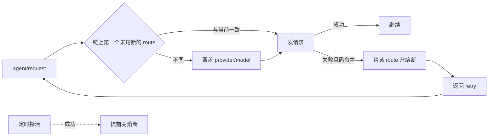

# 模型备用链与主 Session Fallback 方案

> 对应文档：[requirements.md](requirements.md)（第 9 条"长期在线、可恢复、可自愈"）、[upgrade-plan.md](upgrade-plan.md)（F5 模型热切换、F6 托管、F8 抖动告警）。
> 状态：**已实施**（2026-11-08）。P0–P3 全部落地，验收演练待在生产环境跑。实施记录见第十三节。

## 一、为什么现在要做

模型侧目前只有"同一个模型重试"，没有"换一个模型继续"。

- 内核的 `dsh-llm-retry` 默认重试 5 次（0.5–10 秒退避），重试的还是同一个 provider 和 model；重试耗尽后错误直接抛给上层。
- Worker 侧：`DshExecutor` 订阅了 `agent/error`，`transient()` 能识别 408/429/5xx/网络错误，然后 `resumeAfter()` 退避重试——但注释写得很清楚："the model and retry policy are unchanged"。provider 长时间不可用，工单只会被标成失败等人。
- 主 Session 侧：`agent/error` 的处理里 `ticketOf(agent)` 对主 Session 是 undefined，直接 return，**完全没有兜底**。

主 Session 的特殊性决定了它是这次改造的重点：

| 事实 | 后果 |
|---|---|
| 所有 Trigger 的语义判断都要过它 | 它停了，整条 Eval 链路都停 |
| 常驻 + resume，跨重启带着上次的 request header | provider 坏了会一直坏下去，不会自愈 |
| Eval 死线 120 秒、重排队 2 次（`REQUEUES = 2`） | 一次失败最多白等 6 分钟才记 `unavailable` |
| 上下文最长 | 换 provider 的代价最高（prompt cache 全失效） |
| F5：改 `eval.model` 对已存在的主 Session 不生效 | 现在根本没有"运行中换模型"的能力 |

## 二、目标与边界

**目标**

1. 在 Superagent 面板里维护每个角色的"备用链"：从模型目录添加 provider × model（可带 reasoning effort），拖动排序。
2. 主模型失败后按链的顺序自动切换，worker 与主 Session 都覆盖。
3. 失败可见、可告警、可恢复，不静默。

**不做**

- 不动 DSH 内核（不加插件到 profile，不改 checkout）。所有逻辑写在 `dsh-superagent` 自己的代码里，靠 `agent/request` 与 `agent/request-error` 两个应用级挂点。
- 不做网关侧（token.iflink.tech）的渠道路由——那是运营侧的另一件事，不解决"模型级切换"。

> **为什么放在 superagent 而不是内核插件**：这里需要的判断依赖业务上下文（Ticket、Role、Settings、面板、告警），superagent 都有；代价是粒度只到"回合"，做不到"同一步内无缝切换"。对长期运行的智能体来说，回合粒度够用——失败那一轮不进历史，续跑一句就能接上。

## 三、总体设计

三件事：**一条链、一个熔断表、一次探活**。



四个关键决定：

1. **不记录每个会话的落点**。每次请求重新计算，会话的 request header 自动跟着变，UI 与 resume 自然对齐；重启后熔断清零，先试主模型——符合直觉，代码量也少。
2. **主模型不进链**。主模型保留现有的"留空 = 继承 DSH 默认"语义，链只放备用。否则"空链"的含义会被改写，还要处理"默认模型"这一行怎么拖。
3. **失败在 `agent/request-error` 判定**。这个事件天然排在 `dsh-llm-retry` 之后，只会看到重试耗尽的失败，不需要自己记账。
4. **主 Session 用主动探活**，不用真实回合去试错。一次失败的评估代价是 120 秒死线，探活是一个几 token 的小请求。

## 四、数据模型与校验

```ts
// policy.ts
export const RouteSchema = RoleModelSchema          // { provider, model, reasoningEffort? }

export const EvalConfigSchema = z.object({
  ...,
  fallbacks: z.array(RouteSchema).max(5).default([]),
}).strict()

export const ExecutorConfigSchema = z.object({
  ...,
  fallbacks: z.array(RouteSchema).max(5).default([]),
}).strict()
```

保存时的校验（沿用现有 `resolveRoleModel` 探活路径）：

1. zod 结构校验；
2. 按 `provider + model` 去重，且不能与主模型相同；
3. **每一条**都探活一次，失败报 `modelUnavailable`，错误信息点名"备用链第 2 条：kimi-coding/k3"；
4. 上限 5 条。

**不需要数据迁移**：`.default([])` 让老记录解析成空链，行为与现在完全一致。

## 五、面板交互

不新开 tab，跟着概念走：

- **Eval 页**：主模型下面加"备用链"；
- **Execution 页**：执行模型下面加"备用链"。

理由：主模型本来就在这两处，拆开要来回跳；一个 block 一个 SaveBar，符合现有保存规范。

```
主模型    [provider] [model] [effort]              ← 现有 ModelField，不动
备用链    主模型失败后按顺序尝试，链尾之后再失败交给上层重试
 ⠿ 1  cilai-dafeiyu / deepseek-v4.1-flash-1017   ● 正常    [↑][↓] [删除]
 ⠿ 2  kimi-coding / k3                           ○ 冷却中  [↑][↓] [删除]
 + 添加： [provider ▾] [model ▾] [effort ▾]  [添加]
```

- 拖拽用 HTML5 DnD（`draggable` + dragover 算目标下标），不引第三方依赖；**同时保留 ↑/↓ 按钮**，键盘、触屏和 jsdom 测试都靠它。
- 候选项来自现成的 `GET models`（`ctx.sessionController.modelCatalog()` 的 provider → model → efforts），与主模型同一份数据。
- 行尾健康点来自运行时状态；没有就是灰色"未观察"。
- 重复项、等于主模型的项，添加按钮直接置灰。
- 删空 = 不启用 fallback，合法。
- 保存沿用现有 draft / SaveBar；校验错误定位到具体行。

## 六、运行时语义

### 6.1 选路

```
chain(role) = [primary, ...fallbacks]
target = chain 里第一个"熔断未打开"的 route
target ≠ resolved 时覆盖 provider/model/effort（不继承旧 effort）
```

主模型留空时，把失败那一刻的 route 当作链的第 0 位处理。

### 6.2 失败判定

只在这几类失败码上动作：

`RATE_LIMIT` `SERVER` `TIMEOUT` `TRANSPORT` `EMPTY_RESPONSE` `QUOTA` `ACCOUNT_QUOTA` `INVALID_CREDENTIAL` `MISSING_CREDENTIAL`

明确不动：

| 失败 | 归谁管 |
|---|---|
| `CONTEXT_WINDOW_EXCEEDED` | 压缩（compaction） |
| `budget_exceeded` | 现有 `RetryHealth` 的等待逻辑 |
| 参数 / 内容校验错误 | 直接失败，避免掩盖 bug |

命中后：给失败的 route 开熔断（默认 5 分钟），写一条 `plugin:iflink/model-fallback` 记录（模型不可见、跨 fork/resume 保留），返回 `{kind:'retry'}`。链全熔断或超过每步跳数上限时不下决定，让错误照常抛给上层的 transient 重试/失败报告。

### 6.3 恢复

- **Worker**：冷却到期后下一次请求自然回到主模型。
- **主 Session**：degraded 期间每 60 秒用 `ctx.llm.stream()` 发一个极小探活请求（不进 Session、不写日志）；成功即提前关闭熔断，避免拿真实评估去试错。

### 6.4 降级

主 Session 不在主模型上时，Policy 的 `admitsInferred()` 拒绝推断式准入——`auto` 模式下只接受 explicit 请求，推断出来的候选只记 would-accept。恢复后自动还原。默认开启。

理由：备用模型的语义判断质量不确定，而主 Session 的产出是"接不接这张工单"。这正对应需求文档里"自主性应与可靠性相匹配"。

### 6.5 主 Session 失败后的续跑

`agent/error` 里先切路由，再补一句"上一轮模型请求失败，请继续完成上面待评估的候选"。失败的那一轮不进历史，候选卡还在上下文里，不能让 Eval 干等 6 分钟超时。

### 6.6 重启与覆盖面

- 熔断是内存态，重启后清零 → 先试主模型；可选在启动时先探活一次，探不通就直接打开熔断，省掉一次失败回合。
- 覆盖面：worker、主 Session、以及它们派生的 subagent 都走同一套应用级监听器，天然全覆盖。
- 注意：`initializeRoleModel` 的监听器是 `prepend`（最外层），路由器的覆盖监听器必须在它之后注册（后 prepend 更外层）才能压得住，否则创建会话那一刻主模型就挂了会先白失败一轮。seeding 与覆盖应放在同一个模块里，顺序在一处保证。

## 七、代码接点

| 文件 | 改动 |
|---|---|
| `src/policy.ts` | 两个 schema 加 `fallbacks` 与 `RouteSchema` |
| `src/app/settings.ts` | 保存时逐条探活，错误点名行号 |
| `src/app/settings-history.ts` + locale | 新增变更码，历史能看懂"加了哪个模型、顺序怎么变" |
| `src/app/model-router.ts`（新） | 熔断表、选路、失败处理、探活、health |
| `src/app/sessions.ts` | seeding 收进 router；decorate 时装监听、保证注册顺序 |
| `src/executor/dsh.ts` | 主 Session 的 `agent/error` 分支（现在直接 return）+ 续跑 |
| `src/app/views/settings.ts` | 把每条 route 的运行时状态带给面板 |
| `src/client/settings-kit.tsx`、`eval.tsx`、`execution.tsx`、`client.css` | `ModelChainField` 组件、拖拽、行样式 |
| `src/client/locales.ts` | 文案 |
| `tests/` | schema、保存校验、选路/熔断单测、面板拖拽 jsdom 测试 |

## 八、分阶段计划

| 阶段 | 内容 | 风险 | 验收 |
|---|---|---|---|
| P0 数据与面板 | 字段、校验、链编辑器、拖拽排序、保存、历史 diff | 无（链只存不用） | 面板能加/拖/删，保存后重新打开顺序一致；非法 route 被拒并点名 |
| P1 Worker 接运行时 | `ModelRouter` + worker 选路、熔断、恢复 | 中 | 把 worker 主模型指到死端点，工单在备用模型上继续到完成 |
| P2 主 Session 接入 | `agent/error` 分支、续跑、探活、降级准入 | 高（关键路径） | 见第九节演练 1/2/3 全过 |
| P3 可观测与告警 | 面板健康点、`models` health 详情、巡检三态告警 | 低 | 新故障 / 重复提醒 / 已恢复三条消息都能收到 |

## 九、验收演练

1. **主 provider 挂掉**：把主 route 指向死端点 → 群里发一条消息 → 3–5 秒内切到备用 → 评估完成、回复正常 → 收到一条"新故障"告警 → 探活成功后回切 → 收到一条"已恢复"。
2. **备用也挂**：链走完 → 明确失败、不静默 → 告警；degraded 期间不自动接推断工单。
3. **重启**：切到备用后重启进程 → 起来先试主模型（或启动探活直接回主），不重复失败。

## 十、待拍板

| # | 问题 | 建议 |
|---|---|---|
| 1 | 链长上限 | 5 |
| 2 | degraded 时主 Session | 只接 explicit（推荐），不直接暂停 |
| 3 | 探活间隔 | 60 秒 |

## 十一、风险与不做的事

- **KV cache 失效**：每次切换都会让新 provider 重算前缀，主 Session 上下文长，成本要算进预算；靠冷却时间避免来回抖。
- **备用模型能力差异**：上下文窗口、工具调用、reasoning 支持都可能不同。链里只放经过验证的模型；上下文超长仍归压缩，不指望换模型解决。
- **回合粒度**：superagent 层做不到"同一个 step 内无缝切换"，失败的那一轮会被重开。这是选择"不改内核"的代价。
- **不做**：网关层多渠道兜底、按请求计费/配额治理、多实例熔断共享（当前单进程，内存态足够）。

## 十二、工作量

约 **4 天**：P0 1.5 天、P1 1 天、P2 1 天、P3 0.5 天（含测试与演练）。

## 十三、实施记录（2026-11-08）

### 落地的部分

| 计划 | 实现 | 位置 |
|---|---|---|
| 备用链数据与校验 | `eval.fallbacks` / `executor.fallbacks`，最多 5 条；保存时逐条探活并拒绝重复项与主模型重复 | `src/policy.ts`、`src/app/settings.ts`、`src/limits.ts` |
| 历史可读 | 新增 `change.evalFallbacks` / `change.executorFallbacks`，连同顺序一起显示 | `src/app/settings-history.ts`、`src/client/locales.ts` |
| 面板链编辑器 | 加/删/拖动（HTML5 DnD）+ ↑/↓ 按钮 + 行内健康点；候选项来自 `GET models`；重复项按钮置灰并说明 | `src/client/settings-kit.tsx`（`ModelChainField`）、`eval.tsx`、`execution.tsx`、`client.css` |
| 运行时选路 | `ModelRouter`：每次请求读设置，取链上第一个未冷却的路由；主 Session 始终受管（改主模型立即生效，F5 顺手解决），Executor Session 只在跑配置模型时受管 | `src/app/model-router.ts` |
| 熔断与跳数 | 按 provider×model 记冷却（默认 5 分钟），同一 turn/step 最多跳满整条链 | 同上 |
| 主 Session 探活 | 主路由冷却期间每 60 秒发一个 8-token 的探针；成功即提前关冷却 | 同上 |
| 失败后续跑 | 主 Session 的 `agent/error` 分支：路由真的换过才补一句"接着刚才的继续"，不空转 Eval 死线 | `src/executor/dsh.ts`（`masterFailed`） |
| 降级收自治 | 主 Session 不在主模型上时 `admitsInferred` 拒绝推断式准入 | `src/policy.ts`、`src/app/runtime.ts` |
| 可观测 | `model-fallback` health：有路由冷却即 `error`，恢复即 `ready`；同时进 Overview 的 runtime-error 与现有巡检的"健康检查未就绪"告警 | `src/app/runtime.ts`、`src/app/views/settings.ts` |
| 面板状态 | 设置视图带 `routes`，链上每行显示正常/冷却中 | `views/settings.ts`、`client/settings-kit.tsx` |
| 资源 | `models` 资源额外返回 `fallbacks`，主 Session 能看到备用链 | `src/app/resources.ts` |

### 三个待拍板项按建议值实现

- 链长上限 **5**（`LIMITS.fallbacks.max`）；
- degraded 时 **只接 explicit**（`admitsInferred` 返回 false）；
- 探活间隔 **60 秒**（`ModelRouter` 的 `PROBE_MS`）。

### 测试

- `tests/model-router.spec.ts`（8 个）：切到备用、冷却后回主、非 provider 失败不切、走完整条链、Executor 手动选模型不受管、探活成功/失败、每步跳数上限、面板状态。
- `tests/settings.spec.ts`：未知路由与重复主模型被拒且不落库、合法链保存、链内重复被 schema 拒。
- `tests/policy.spec.ts`：降级时 `admitsInferred` 为 false。
- `tests/panel-settings.spec.tsx`：加两条 → 重复项置灰 → 上移 → 删除 → 保存，断言落库顺序。

`npx tsc --noEmit` 通过；`npx vitest run` 仅剩两个与本次无关的用例（环境里 git 报中文错误、飞书事件消费在并行负载下偶发超时）。

### 未做 / 已知限制

- 拖拽本身没有被 jsdom 测试覆盖（HTML5 DnD 在 jsdom 里不可靠），由 ↑/↓ 按钮承担键盘与测试路径；真机上需手工点一次。
- 备用链不按 `contextWindow` 过滤：备用模型窗口更小时，请求会以 `CONTEXT_WINDOW_EXCEEDED` 失败，不换模型（归压缩）。
- 只覆盖 superagent 自己的 Session；DSH 的标题生成、压缩摘要等旁路调用不受管。
- 主 Session 的续跑语句是通用文案，没有点名具体候选——它从历史里就能看到。

### 如何试用

1. `npx tsdown` 已重新构建 `lib/`；跑 `systemctl --user restart dsh-superagent.service` 让进程加载新代码（模块在启动时挂载，必须重启一次）。
2. 打开面板 → **Eval**（主 Session）/ **Execution**（执行器）→ 设置 → 备用链：从目录挑 provider + model 加入，拖动或用 ↑/↓ 排序，然后保存。
3. 演练：把主模型临时指到一个死端点，在群里发一条消息，观察它切到备用、回复发出、`model-fallback` health 报错、探活后回切；演练完删掉那条死路由。
