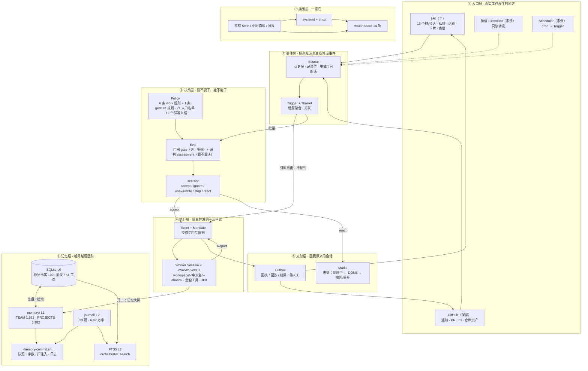
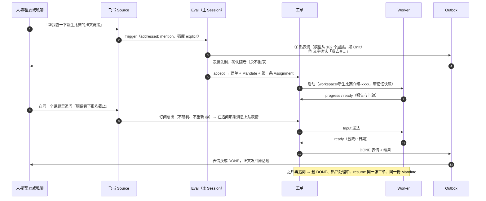
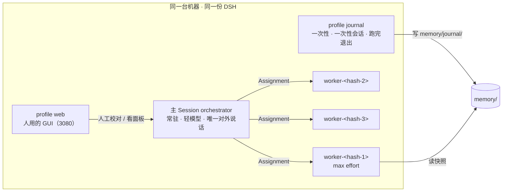

# IFLink Team Agent 整体框架

> 写于 2026-11-09。梳理对象：`dsh-superagent-prototype-IF.Link`（在跑的服务）+ `~/TeamAgent`（记忆、技能、运维）。
> 分三部分：**一、继承的主干**（原本的架构）→ **二、我们叠上去的六层改进** → **三、合起来的整体框架**。

---

## 〇、一句话

> 拿 DSH Super-agent 的「事件驱动 + 双层会话」主干，长成一个**住在飞书里、有团队记忆、能自我运维**的 AI 同事：
> 它把 88% 的群消息收下但不说话，接住明确的活，干完在原来的消息上点一个表情、在原群里交结果。

三个数字概括当前状态（2026-11-09 20:30 实取）：

| 维度 | 数字 |
|---|---|
| 输入 | 1,079 条 Trigger（人 1,044 / 机器人 35；群里 @ 98 / 私聊 69 / 未 @ 912） |
| 判断 | 1,077 次研判：**ignore 949（88%）**、unavailable 73、accept 51、stop 2、react 2 |
| 产出 | 51 张工单：completed 41 / dropped 6 / stopped 2 / 在办 2；文字发出 142 条、回执 65 条、表情 128 次 |

---

## 一、继承的主干：原本是什么

### 1.1 上游思想（《Super-agent 设计探索》，`docs/iflink/super-agent-design.md`）

四个特征：**连续**（人感觉只有一个同事）、**高效**（并发多任务）、**主动**（看环境事件而不是等人敲字）、**持久**（一直在、自己恢复）。

两个关键的结构选择：

- **双层架构**：常驻的 **Router 层**统一承接人类交互与全局协调，隔离的 **Worker 层**并发执行。理由是连续性与吞吐量的根本权衡——单 Session 最连续但串行，全开新 Session 最快但割裂。Router 只做轻判断（长输入短输出），所以单 Session 不成瓶颈，因为上一轮推理期间到达的事件会积压成一批一起处理（**Batching**）。
- **事件驱动**：输入从"人打的提示词"换成"半结构化环境事件"，即 **Trigger**。围绕一条 Trigger 的生命周期解决四件事：两级过滤（程序 + 模型）、订阅与直通路由、上下文组织（Inline & Spill + 链式召回）、投机执行（提前行动）。

### 1.2 原型落地：`dsh-superagent` 的领域模型（`docs/001-domain.md`）

原型把上面这套想法做成了 11 个领域概念，每个都带"它守的规则"和"为什么存在"：

| 概念 | 一句话 | 最容易被忽略的规则 |
|---|---|---|
| Source 来源 | 一条事件流（kind 实现 + instance 配置） | 自己记读位、自己认身份；重启不重放 |
| Trigger 触发 | 一条不可变事件 | 同一条收两次只产生一张工单（幂等单位） |
| Thread 线程 | 同一话题的 Trigger 序列 | 一条 Thread 同时只跑一个 Eval，期间的 Trigger 合并进下一批 |
| Correlation 关联 | 跨 Thread 的同一 Trigger | 只加语境，不路由 |
| Channel 渠道 | Thread 的写侧 | 回执、回复、表情、PR、评审都是"写" |
| Policy 策略 | 版本化的准入规则 + 各 Source 的名单 | 版本号进了每张 Mandate；改规则不撤销已授的权，只通知 |
| Eval 评估 | 两层判断：**门闸 gate**（确定性：谁可以发起、强度多大）+ **研判 assessment**（模型：这算不算活） | 无状态，输入是批 + 线程快照 + 该线程所有工单 + 当前 Policy |
| Mandate 授权 | accept 授予的东西：版本、范围、强度、命中的规则、发起人身份 | 不可变；只有人 stop 或 Policy 失效能撤回；工单结束不等于授权结束 |
| Ticket 工单 | 授权工作的单位 | **只有 Eval 能建**；自己有状态，不跟 Session 走（可换执行器、可续跑） |
| Assignment 派工 | 工单与某个执行器实例的绑定 | 一张工单一生有多次；只有最终报告能从执行器侧结束工单 |
| Subscription 订阅 | 工单 ↔ Thread 的多对多，存在 Thread 上 | 匹配的 Trigger **直接扇出**给订阅工单，不再走 Eval——后续讨论不用重新 @ 它 |

配套的三条"反直觉"设计（文档里明确列为 *Rejected concepts*）：不要 Principal/Membership 实体、不跨 Source 映射身份、不做"等待中/已撤销"的 Eval 状态、不为"追加到工单"设计一个 Decision、Policy 变更不取消在跑的工单。

### 1.3 工程骨架（`docs/007-architecture.md`）

16.5k 行 TS、114 个源文件、64 个 spec、8 篇编号文档（000 哲学 → 008 手册）。

```
Runtime（组合根，无领域规则）
 ├── Engine（唯一写 Trigger/Thread/Decision/Ticket/Assignment 的人）
 │    ├── Intake    收事件、扇出、排队研判
 │    ├── Evals     批处理、门闸、死线、Decision
 │    ├── Tickets   工单生命周期、订阅、Input、resume/stop
 │    ├── Assignments 执行器上报的事实、报告、提问
 │    └── Replies   回执 / 回答 / 结果 / 待人工（都经 Outbox）
 ├── Policy（设置 schema + 门闸 + Mandate 复核 + 版本哈希）
 ├── SourceRegistry（插件：kind + instance + Channel + 健康项）
 ├── MasterAssessor（让主 Session 做研判）
 ├── DshExecutor（一单一 Session 一目录，WorkerSlots 限并发）
 ├── Effects（持久副作用队列：assessment/launch/delivery/relay/notice/reply）
 ├── Store（单 SQLite，触发/线程/工单/决策/回执/effect/kv）
 └── Prompts / Sessions / Settings / 面板（只读回环 HTTP + React）
```

两个必须记住的工程约束：

- **一个状态只有一个写者**（表在 007 文档里逐项列出）；Source 只能通过 `bindThread` / `threadClosed` 改工单。
- **Effect 是唯一的跨进程副作用通道**：命令在事务内 `enqueue`，提交后才执行；同一 kind+key 只有一行，重复入队即合并；失败指数退避，`Later` 表示"延后但不算失败"。

### 1.4 双层 = 两种 DSH Session

| | 主 Session（`orchestrator`） | 执行器 Session（`worker`） |
|---|---|---|
| 数量 | 常驻 1 个 | 每张工单 1 个（并发上限 `maxWorkers`） |
| 模型 | 轻/快（现 `self-ds` high） | 强（现 `self-ds` max） |
| 工具 | `orchestrator_*`（读资源、决策、回复、附加工单） | 全套执行工具（bash/文件/搜索/子 Agent/skill） |
| 对外的嘴 | **只有它能说话** | 不直接对人说话，只向工单报 Report |
| 上下文 | 全局连续（团队记忆、跨项目关联） | 单任务隔离（工单目录 + 记忆快照） |

---

## 二、我们叠上去的六层改进

改造原则（来自 `docs/iflink/upgrade-plan.md`）：**保留主干，不重写 Worker / Mandate / Subscription / Effects / Outbox**；先跑通再变聪明；Coding Agent 就是 General Agent；不提前固化团队/项目关系。

代码层面其实很小（相对原型：+4,638 / −110 行，77 个文件），真正花时间的是"怎么让它被团队接受"。

### 改进 1｜重心从 GitHub 搬到飞书

**为什么**：原型默认"一个 GitHub 仓库的主动 coding agent"，每条链路都假定有仓库、有 PR、工单目录是英文 slug。我们第一场景是群里 @ 它。

**做了什么**

| 改动 | 落点 |
|---|---|
| GitHub Source 变可选（原来 `resolveDeployment` 无条件抛 `repositoryUnset`，服务起不来） | `src/deployment.ts`、`src/app/setup.ts` |
| 工单目录名不再强制英文 slug（现在就是 `workspace/新生比赛介绍-db749f9b0d49`） | `src/executor/dsh.ts` |
| 去 git 化措辞：提示词与卡片不再默认"提交 PR 即交付" | `prompts/team/*`、`src/app/notices.ts` |
| 飞书 Source 按群配准入：群内 `listen: all`、私聊开、其他群只在被 @ 时进；历史回补 + 话题轮询 | `src/sources/feishu*.ts` |
| 历史恢复按群记账：单个群连续 3 轮失败才把组件打成 error，单轮降级为 `(degraded)` | `src/sources/feishu-loops.ts` |

**现状**：飞书接入 15 个群/会话、21 人白名单、12 个群有独立准入格；GitHub 仍是 `enabled: true` 但实际 **0 触发**（配置在，链路在，用途暂缺）。

### 改进 2｜双身份：bot 为主，个人身份兜底

**为什么**：这是产品问题不是技术问题。本应用 240 个 scope 里 bot 最多只能用 50 个，且已经全部申请完、没有余量。补授权解决不了，只能换身份。

| 身份 | CLI | 干什么 | 红线 |
|---|---|---|---|
| 应用身份（`IFLink TeamAgent` bot） | `lark-bot` | 默认：群消息、卡片、已有文档读写与评论、知识库读、日历、任务、妙记 | — |
| 维护者个人身份 | `lark-user` | 只在 user-only 能力上出现：多维表格/电子表格、搜历史消息、上传下载、新建文档、知识库写入、按姓名查人 | 不以个人名义发言、不代审批、不做对外承诺 |

**关键设计**：身份不是 Worker 临场猜的，而是**写死在 Skill 里**的固定入口；判断依据是"这个能力 bot 有没有 scope"，而不是"我觉得谁更合适"。另外资源授权是**独立前置条件**——身份只决定"能不能做"，资源决定"能不能看到"（群、知识库、文档都得单独加它/加协作者）。

### 改进 3｜三层记忆 + 一个检索

**为什么**：Session 会 compaction，团队事实不能靠"上次聊过"。但让模型自由编辑记忆文件，很快会得到一堆互相矛盾的过期事实。

| 层 | 存什么 | 谁写 | 预算 |
|---|---|---|---|
| L0 原始事实 | 每条 Trigger/Thread/Decision/Ticket 与回执 | Engine（自动） | 不限（SQLite） |
| L1 团队记忆 | `TEAM.md` 团队与协作约定、`PROJECTS.md` 各项目线现状、`PEOPLE.md`（可选） | 复盘 → 一个脚本 | **2,000 / 6,000 / 1,500 字符** |
| L2 周期流水 | `journal/YYYY-MM-DD_MM-DD.md`，按「项目｜/组｜」分节，**只追加不改** | journal profile 批量生成 | 周记 1,800 / 两日 600 |
| L3 检索 | FTS5 trigram 覆盖工单、触发、决策 + journal 文件索引 | `orchestrator_search` | 中文 2 字词有 LIKE 兜底 |

**一扇门**：写入只能走 `scripts/memory-commit.sh`——写前快照到 `.versions/`（现有 68 份）、查字数上限（超限拒绝，逼你合并而不是追加）、扫注入、记变更日志（现有 300 条）、被拦下的进 `.rejected/`。整篇替换，不做追加。

**读路径分角色**：主 Session 不把记忆塞进系统提示（系统提示里只有一条恒定指针），需要时用 `orchestrator_read memory` 先看索引再读单篇；Worker 开工时拿到工单目录里的 `memory/` **快照**——避免它边干边被新记忆改变前提，也让"当时依据什么"可回查。

**journal 生产线（2026-11-09 换代）**：旧的 `journal-run/daily/backfill/batch.sh` 与 journal profile 已全部移到 `.retired/`；现在由 `scripts/dream.sh` + `dream-work/AGENTS.md` 在每两天 08:30 一次跑完（校正草稿 → 更新 TEAM/PROJECTS → 写两日档 → 保小 → 整理技能 → 归档）。现在 **32 篇 / 约 5.9 万字符**，覆盖 04-01 → 11-08，回去补历史用 `dream.sh <起> <止> --history`。

**现状提醒**：`TEAM.md` 1,983 / 2,000、`PROJECTS.md` 5,982 / 6,000——两个文件都贴着上限，下一轮必须合并。

### 改进 4｜表情回执与社交反应（注意力经济学）

**为什么**：它说话很少（88% 研判是 ignore），但"不说话"不等于"不在场"。一个表情的成本是一个像素，不是一段注意力，所以可以用比发言宽松得多的标准发。

两条独立的机制：

**① 工作回执（mark）**——挂在"人写的那条消息"上

| 时机 | 表情变化 |
|---|---|
| 明确请求被接单（`@` 或私聊，`strength: explicit`） | 贴"处理中"，**排在文字确认之前** |
| 工单接下的每条追问 | 在追问的那条消息上各贴一条 |
| 结束 `completed`/`merged` | 删旧 → 贴 `DONE` |
| 结束 `stopped`/`dropped`/`closed` | 删掉，不留痕 |
| 已结束的工单被追问唤醒 | 删 `DONE` → 贴回处理中 |
| **推断接单**（没人 @，它自己判断） | **不贴**——没人问它，表情会像插话 |

工程要点：工单上记 `marks: string[]`，"全部一起变"是查出来的不是猜的；id 由 trigger 派生（`key('react', triggerId)`）所以幂等；**失败只试一次**，绝不挡住排在后面的文字回复。

**② 表情由模型挑**：飞书全部 **182 个表情**（带中文语义 + 是否适合工作场合），用 Cloudflare Workers AI 的 `clef-flash`（System One 协议，一次请求一个 choice 问题）；输入是消息原文 + 本次研判的 decision 与理由 + 工单标题范围 + 线程最近 5 条；输出 `{emoji, tone, confidence}`，不在 182 白名单里的直接拒。成本约 4k 输入 token / 次（免费额度约够 300 次/天）。没配账号 → paused，超时 4s / 失败 / 非法值 → 静默回退固定 `OnIt`。

**③ 社交反应（gesture）**：新增一种 **Decision `react`**——不需要干活、但值得给个反应的群消息（报喜、道谢、接梗、自嘲），只贴表情、不建工单、不说话。三件配套：研判规则里多一种 `kind: "gesture"` 的打分规则（0–5 分）；**配额**（同一个人 30 分钟内不重复、每群每小时最多 2 次，落 KV 所以重启不重置）；**模式** `off / observe / auto`。

**现状**：128 次表情（received 54 / finished 37 / reopened 22 / withdrawn 13 / gesture 2）。`gestures.mode` 仍是 **observe**（只记录不发射），一次 `gestureBudget` 拒绝已被记进 Decision。

### 改进 5｜模型备用链与热切换

**为什么**：provider 抖一下，主 Session 一卡就是一次 Eval 死线超时（73 次 unavailable 大头在这里），Worker 卡住就是一张工单烂在那。

**做了什么**（`src/app/model-router.ts`）

- 两个角色各有**有序备用链**（`eval.fallbacks` / `executor.fallbacks`，面板里可拖拽排序），每项是 provider × model，重复项直接拒绝。
- **每次请求重读设置**——改主模型、改链条，下一次请求就生效，不用重建 Session（F5 已关）。
- 只有 provider 侧故障才切（RATE_LIMIT/SERVER/TIMEOUT/TRANSPORT/EMPTY_RESPONSE/QUOTA/AUTH/NO_ADAPTER/UNKNOWN_MODEL），请求本身错的错误不切。
- 失败路由进入冷却（默认 5 分钟）；主 Session 冷却期由**探针**（8 token）每 60 秒试活，恢复后自动回切；降级期间**不再自动接推断工单**（宁可不接，也不接一半）；`model-fallback` 健康项进 Overview 与巡检告警。
- 路由切换写成 `plugin:iflink/model-fallback` 审计记录，不进模型可见历史。

**现状**：研判与执行都在自建 vLLM（`self-ds`）→ `self-ds-2` → `cilai-dafeiyu` 网关；健康项报"所有备链路由可用"。

### 改进 6｜运维：巡检、自愈、报警闭环

**为什么**：它得 7×24 在，而事故已经真发生过——11-05 23:36 巡检用 `start` 重启，tmux 落在一次性 unit 的 cgroup 里，unit 退出时把刚救回来的进程一起掐了，服务死了 23 分钟。

**现在这套**

| 组件 | 频率 | 干什么 |
|---|---|---|
| `dsh-superagent.service` | 常驻 | systemd user unit（oneshot + `RemainAfterExit` + tmux） |
| `teamagent-monitor.timer` | 每 5 分钟 | 纯系统检查，**不调用任何模型**：服务/健康、系统指标、业务指标（只读 SQLite）、令牌时效、错误日志 |
| `dsh-superagent-check.timer` | 每小时 | 不健康就 `systemctl --user restart`（保留"人工停过不自动拉起"） |
| `teamagent-journal-daily.timer` | 每天 08:30 | 每两天写一篇团队日记 |

报警三条规矩：**三态闭环**（新故障 / 重复提醒 / 已恢复，恢复时把上次报的原样念回来）、**签名抹掉数字后 6 小时内只报一次**、**连续两次巡检都看到才算数**（拦单次抖动）。日报会原样列出昨日复盘改了哪些记忆（diff），被拦下的提交也报一句。

**现状**：14 项健康全 `ready`；上一次报警是「投递 2 条消息未发出」+「近 24 小时 71 次模型不可用」。

---

## 三、合起来：整体框架

### 3.1 分层总览



### 3.2 一条消息的一生（含表情与追问）



### 3.3 会话拓扑



四个 profile 各管一件事：`superagent`（生产：主 + 执行器）、`journal`（写日记，headless 派生，跑完即退）、`web`（人操作的 GUI）、`headless`（模板）。面板管理 API 强制回环，只能 SSH 隧道进。

### 3.4 准入模型（最该被理解的一块）

一条消息能不能变成工单，是**确定性门闸 + 模型研判**两层，加上一份**版本化 Policy**：

```
谁能进：  白名单 21 人（主 Session 群内/私聊不限） 或 群准入格（12 个群：非名单成员 @ 也算 explicit）
多强：    explicit（明确点名） / inferred（推断）——只有 explicit 才贴表情、才算"他问过我"
干什么：  6 条 work 规则（历史查询 / 决策记录 / 无人认领 / 核对 / 跨群同步 / 进展汇总）
         每条都必须给出"交付物 + 不算的情况 + 依据要求"，模型逐条判 matched/not
边界：    accept 之后进 Mandate（Policy 版本 + 范围 + 命中的规则），Worker 只在这个范围里动手
改规则：  Policy 版本变化 → 只通知受影响的在办工单，不撤销授权、不取消在跑的活
不想干：  observe 只记录不执行；paused 全局暂停（死线跟着顺延）
```

这解释了那个 88%：**大部分群消息不值得做**，而"不做"也要留痕（Decision 记 reason code），所以能复盘"它当时为什么没动"。

### 3.5 现状面板

| 层 | 指标 | 现值 |
|---|---|---|
| 入口 | 飞书接入 / 白名单 / 准入格 | 15 个会话 / 21 人 / 12 格 |
| 事件 | Trigger 总量 · human/bot · @/私聊/未 @ | 1,079 · 1,044/35 · 98/69/912 |
| 决策 | 研判总量 · ignore · accept · unavailable | 1,077 · 949 · 51 · 73 |
| 执行 | 工单 · completed · 在办 | 51 · 41 · 2 |
| 交付 | 文字 / 回执 / 表情 | 142 / 65 / 128 |
| 记忆 | TEAM · PROJECTS · journal | 1,983/2,000 · 5,982/6,000 · 33 篇 |
| 技能 | `skills/` 团队技能 | 27 个（走同一把写入闸门） |
| 运行 | 健康项 · 定时器 · 工单并发 | 14 全 ready · 3 个 · 3 |

近 5 天工单量：11-05 4 张 → 11-06 12 → 11-07 10 → 11-08 13 → 11-09 12，已经稳定在"一天十几张真实任务"。

---

## 四、设计取舍（为什么这么长）

| 取舍 | 我们的选择 | 代价 |
|---|---|---|
| 先跑通还是先变聪明 | **先跑通**。P0"能收到/能干活/能回复"验证完才动记忆 | 记忆与冷启动晚了两天，但每个决策都有真实数据 |
| 记忆大而全还是小而准 | **小而准**：两个文件贴着 2,000/6,000 字符上限跑 | 必须持续合并，人工校对不能省 |
| 谁可以写记忆 | **只有一扇门**（一个脚本 + 人确认） | 自动化程度低，但没出现互相矛盾的过期事实 |
| 多 Agent 还是一个 Agent | **一个 Router + 多个 Worker**，不按项目组拆 | 全局上下文连续，但 Router 是单点（靠 Batching 撑住） |
| 身份边界 | bot 为主、个人兜底、写死在 Skill 里 | 个人令牌 7 天要扫码，且这条边界必须公开讲清楚 |
| 说话还是不说 | **默认不说**：88% ignore，表情代替发言 | 有人会觉得它"不够主动"（需要人判断要不要放开） |
| 主动化的节奏 | gesture 停在 `observe`，不急着开 `auto` | 少了一点"在场感"，换的是不打扰 |

**明确不做**（写进方案的边界，不是待办）：不按项目组拆多个 Router；不建团队/项目/成员重型表；不用一个不断增长的大文件当记忆；不重写 Worker/Mandate/Subscription/Effects/Outbox；不继续给 bot 追加权限（平台已无可用项）；不让个人身份承担对话表达；不让模型自动生成的 Skill 未经确认就全局生效；不在第一阶段上向量库/GEPA/语义 Watchdog。

---

## 五、已知缺口（截至 2026-11-09）

| # | 缺口 | 现状证据 | 建议 |
|---|---|---|---|
| 1 | **Review Effect 没做**：复盘还是"半自动"（`memory/REVIEW.md` 是作业指导，靠人或主 Session 触发） | `effect` 表 0 行；`memory/.journal` 300 条变更都来自人工/脚本 | 工单完成时落一条持久 Effect，拉起独立复盘会话，产出提案待人确认 |
| 2 | gesture 仍是 `observe` | `policy.gestures.mode = observe`；只有 2 次 gesture 真发出 | 观察窗口够了就单个群灰度升 `auto`，看噪音反馈 |
| 3 | 服务托管仍是 `oneshot + tmux` | `dsh-superagent.service` Type=oneshot；11-05 挂过一次 | 改 `Type=simple` + `Restart=always`，日志走 journald |
| 4 | GitHub Source 在跑但零触发 | `stats.received: 0` | 要么关掉（走 inert 分支），要么改成"放团队资产/技能"的用途 |
| 5 | 面板只能回环访问 | `http.ts` 强制本机 | 要给团队看，另做只读视图，不要放开管理 API |
| 6 | App Secret 曾明文出现 | 改造记录 | 尽快在开发者后台重置 |
| 7 | 记忆两个文件贴上限 | 1,983/2,000、5,982/6,000 | 下一轮必须合并；或把 PROJECTS 按项目线拆成多文件 |
| 8 | 个人令牌 ~7 天过期要扫码 | 巡检有 `<48h` 提醒、`<12h` 报警 | 训练一位成员会续，或改用专用服务账号 |

---

## 六、给开发者的文件地图

| 想改什么 | 从哪进 |
|---|---|
| 领域规则（什么算工单、何时结束、订阅扇出） | `src/core/*`（先读 `docs/001-domain.md`） |
| 准入与研判（规则、名单、强度、版本） | `src/policy.ts`、`src/admission.ts` |
| 飞书/ GitHub 收发 | `src/sources/feishu*.ts`、`src/sources/github*.ts` |
| 执行器（目录、并发、恢复、报告） | `src/executor/dsh.ts`、`src/executor/background.ts` |
| 记忆与检索、表情 | `src/app/resources.ts`、`src/app/store.ts`（FTS）、`src/app/marks.ts`、`src/feishu-emojis.ts` |
| 模型路由 | `src/app/model-router.ts`、`src/app/role-models.ts` |
| 提示词 | `prompts/*.md` + `prompts/team/*.md`（面板 revision 12 生效） |
| 团队记忆 | `memory/*.md`（只经 `scripts/memory-commit.sh`）、`memory/journal/` |
| 团队技能 | `skills/<名字>/SKILL.md` |
| 运维 | `BuildTeamAgent/teamagent-monitor.sh`、`scripts/dsh-superagent`、systemd user units |

设计文档按顺序读：`docs/000-philosophy.md` → `001-domain` → `002-authorization` → `003-execution` → `004-prompts` → `005-panel` → `006-deployment` → `007-architecture`；IF.Link 的实践记录在 `docs/iflink/`。
