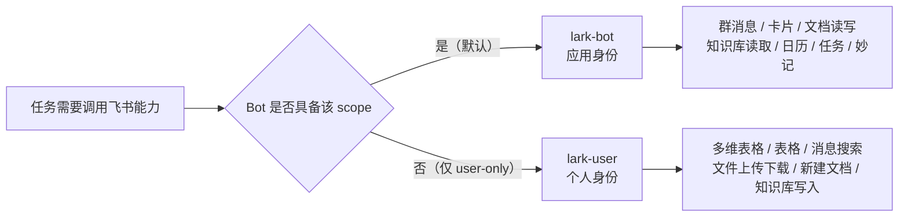
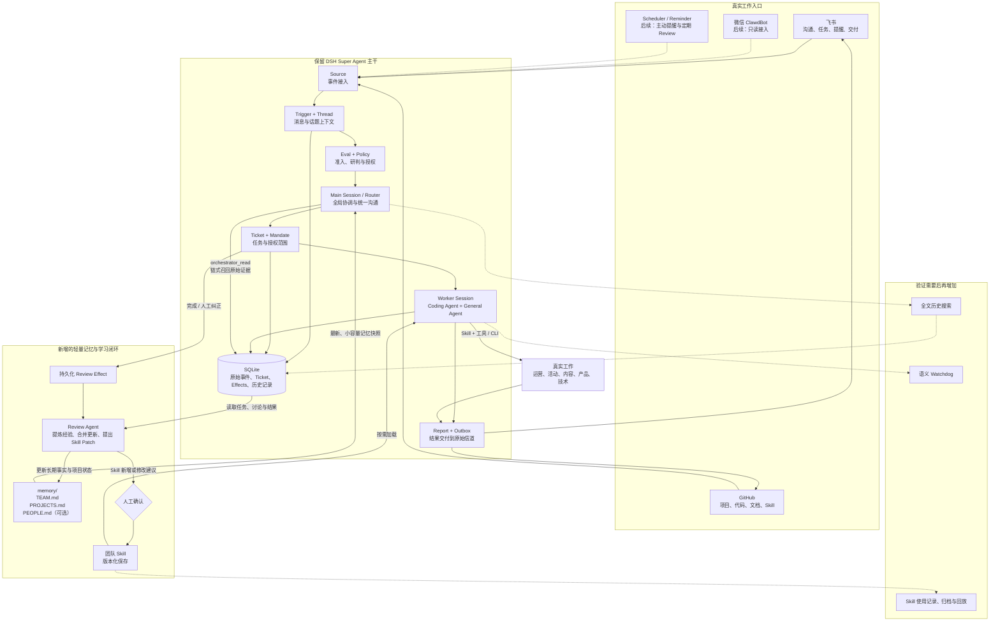

# IFLink Team Agent 改造升级方案

> 对应文档：[IFLink Team Agent 需求说明](./requirements.md)  
> 方案定位：在 DSH Super Agent 现有思路上进行针对性补强，先形成最小可用闭环，再按实际效果逐步扩展。

## 一、改造目标

以现有 DSH Super Agent 为基础，将其实现从“面向代码仓库的主动 Coding Agent”，逐步扩展为“了解 IFLink 各业务线、能够持续学习并完成多类型工作的 Team Agent”。

改造分两步走，顺序不能颠倒：先让它作为一个能干活的新同事上线，再让它逐步变聪明。

**第一步（当前重点）：先跑起来**

```text
成员在飞书群里 @ Team Agent
  → 产生 Ticket
  → Worker 执行
  → 把结果回复到原群
```

这一步只验证一件事：它在线、能收到、能干活、能回复。记忆、冷启动、主动化全部留到之后。

**第二步：再让它学习**

```text
团队完成真实任务
  → Review Agent 提炼长期有用的经验
  → 更新团队记忆或提出 Skill 修改建议
  → 后续任务自动获得这些记忆与能力
  → 更少重复解释、更少重复犯错、更稳定地交付
```

## 二、改造原则

### 1. 保留 Super Agent 主干

继续沿用现有机制：

```text
Source → Trigger → Thread → Eval
→ Ticket / Mandate → Worker
→ Report → Outbox → 原始信道
```

Router 继续负责全局协调与统一沟通，Worker 继续按 Ticket 隔离并发。Subscription、Effects、SQLite、Outbox、持久化恢复和现有授权体系不重写。

### 2. Coding Agent 就是 General Agent

现有 Worker 已能加载 Skill，并使用文件、Shell、搜索、Web、子 Agent 等工具。因此不重写所谓“通用执行器”。

新增工作优先通过“业务 Skill + 现有工具/CLI”完成，只有确实缺少工具时才补工具。

### 3. 不提前固化团队与项目关系

核心成员高度重叠，飞书群大体承担项目组或团队边界。项目之间允许交叉、变化和模糊，不提前建设团队表、项目表、成员关系表，也不按项目组拆成多个 Router 或多个 Agent。

### 4. 先文件、后系统；先验证、后扩展

先使用小容量记忆文件和独立 Review Agent，验证记忆与学习是否真正改善后续任务。全文检索、Curator、语义 Watchdog、向量检索和 GEPA 等能力，根据实际效果逐步增加。

## 三、身份与权限模型

Team Agent 在飞书上使用两个身份，职责固定、互不重叠：

| 身份 | CLI 入口 | 归属 | 承担的工作 |
|---|---|---|---|
| Bot 应用身份 | `lark-bot` | 应用 `IFLink TeamAgent` | 默认身份：群内沟通、收发消息、交互卡片、已有文档读写与评论、知识库读取、日历、任务、妙记 |
| User 个人身份 | `lark-user` | 团队维护者 | 兜底身份：Bot 在平台层面确实做不到的能力 |

现阶段直接复用个人账号，不新建专用服务账号。

### 1. 能力上限由平台决定

本应用共 240 个 scope，按可用身份分布如下：

| 类型 | 数量 | Bot | User |
|---|---|---|---|
| 同时支持 user 与 tenant | 32 | ✅ | ✅ |
| 仅 tenant（Bot 专属） | 18 | ✅ | ❌ |
| 仅 user | 190 | ❌ | ✅ |
| 合计 | 240 | **50** | **222** |

Bot 的可授权上限就是这 50 项，目前已经全部申请并生效，没有剩余可申请空间。因此“某项能力 Bot 用不了”不是权限漏配，而是平台约束——只能换身份，不能靠继续加权限解决。

### 2. Bot 用不了的能力

| 能力 | 相关 scope |
|---|---|
| 多维表格、电子表格 | `base:*`、`sheets:*` |
| 全局聊天搜索 | `search:message` |
| 云盘文件上传、下载 | `drive:file:upload`、`drive:file:download` |
| 新建云文档 | `docx:document:create` |
| 知识库建节点、加成员 | `wiki:node:create`、`wiki:member:create` |
| 按姓名查人 | `contact:user:search` |
| 邮件、审批、OKR、会议检索、查忙闲 | `mail:*`、`approval:*`、`okr:*`、`vc:*`、`calendar.free_busy:read` |

反过来，群消息接收与发送、交互卡片、已有文档的读写与评论、云盘元数据、知识库读取、日历日程、任务、妙记，Bot 都能独立完成，且应始终优先使用 Bot。

### 3. 路由规则

默认 Bot；仅当所需能力落在下列清单内时才切到 User：

- 读写多维表格、电子表格；
- 搜索历史消息；
- 上传或下载云盘文件；
- 新建云文档；
- 在知识库中创建节点、调整空间成员；
- 按姓名解析成员。

User 身份的使用红线：

- 不以个人名义在群里发消息、回复或表态；
- 不修改群设置、不代替本人审批；
- 不执行对外承诺类动作；
- 只做“取数据、传文件、建结构”这类有限动作。

判断方式不靠临场猜测：Skill 中写明每一步该用哪个通道，代码侧就是两个固定入口 `lark-bot` 与 `lark-user`。



### 4. 为什么默认用 Bot

- 署名正确：群内是机器人身份，而不是维护者本人；
- 长期可用：tenant token 自动维护，不受个人令牌过期影响；
- 边界清晰：Worker 默认 CLI 仍保持 strict-mode `bot`，个人身份是一条显式、范围受限的旁路；
- 影响可控：个人身份只出现在少数确定性操作上，容易审计。

### 5. 令牌与降级

- User 令牌有效期约 2 小时，刷新令牌约 7 天，过期后需重新扫码授权；
- User 通道不可用时，降级为纯 Bot 运行，并明确报告“该能力暂不可用”，不静默失败、不伪造结果；
- Bot 访问无权的用户资源时返回的是“空成功”而非报错（实测群列表返回 `null`、知识空间返回 `[]`，`ok` 仍为 `true`），因此判断资源是否缺失必须看返回内容，不能只看调用是否成功。

### 6. 资源授权是独立前置条件

身份只决定“能不能做”，资源决定“能不能看到”。Bot 必须被显式加入：

- 目标群聊；
- 目标知识空间；
- 需要访问的文档与文件夹（加为协作者）。

个人身份天然可见自己的资源，但同样受个人权限限制，团队共享资源仍需单独授权。这部分属于上线前置动作，不写在代码里。

## 四、需求与现有能力对照

| 需求 | 现有基础 | 主要缺口与补强方向 |
|---|---|---|
| 团队整体上下文 | 固定 Main Session、SQLite、Trigger/Thread/Ticket、链式召回 | 缺少经过整理的团队记忆和项目当前状态，增加小容量记忆文件 |
| 跨会话长期记忆 | Session 持久化、Compaction、业务状态持久化 | 原始事实可保存，但不会自动提炼；增加 Review Agent |
| 多业务线并发 | 一个 Router、多个隔离 Worker、Subscription 直通 | 主干保留，仅需补充业务 Skill 和必要工具 |
| 飞书沟通与主动协作 | Feishu Source、准入、Eval、Outbox | 主动提醒需要 Scheduler Source；主动场景逐步从 observe 升到 auto |
| 跨平台连续 | GitHub、飞书已有统一 Trigger/Ticket 模型 | 后续按 SourceKind 增加微信只读 Source |
| 全能真实工作 | Coding Agent 已有通用工具和 Skill 加载能力 | 不重写 Worker，补充运营、活动、内容、产品等 Skill；飞书能力面通过 Bot + 个人身份双通道补齐 |
| 团队智慧沉淀 | Prompt/Skill 可保存、版本化并注册到 Session | 缺少自动生成、审核和复用经验的闭环，增加 Skill Review 与 Patch |
| Always On | 服务脚本、Effects、重启恢复、外部小时检查 | 先复用现有能力，按实际运行情况再补系统级加固 |
| 可信与可控 | Policy、Mandate、显式人工停止、历史记录 | 记忆和 Skill 修改初期人工确认，保留来源、版本和回滚能力 |

## 五、目标架构



## 六、重点改造内容

### 1. 小容量文件记忆

先采用简单结构：

```text
memory/
├── TEAM.md        # 团队稳定事实、共同工作方式、重要约定
├── PROJECTS.md    # 各项目当前状态、关键决策、待办与风险
└── PEOPLE.md      # 可选：核心成员长期偏好与协作习惯
```

基本要求：

- 原始聊天、任务和执行记录继续留在现有 SQLite，不重复抄写；
- `TEAM.md` 只保存长期有用的信息；
- `PROJECTS.md` 按自然项目名分段，不要求严格的项目归属；
- 文件保持小容量，由 Review Agent 合并、更新和清理过期内容；
- Router 在模型请求时读取最新的小文件，避免常驻 Session 看不到新记忆；
- 现有链式召回继续负责查找原始证据。

### 2. 独立 Review Agent

新增持久化 Review Effect，在以下情况触发：

- Ticket 完成；
- 成员明确纠正 Agent；
- 后续需要时，再增加项目里程碑、定期或空闲 Review。

Review Agent 独立于 Router，复用 Worker 的读取和文件能力，负责：

- 判断哪些内容值得长期保留；
- 更新团队事实与项目状态；
- 合并重复经验，修改过期内容；
- 提出 Skill 新增或修改建议。

提示词重点约束：

- 记录经验，不记录流水账；
- 不猜测成员性格、能力或长期偏好；
- 一次性要求不能自动变成长期规则；
- 优先更新旧内容，不重复追加；
- 修改前先读取原文件；
- 保留对应 Ticket/Thread 来源，便于回查；
- 不确定时宁可不写。

初期记忆修改与 Skill 修改均可先经人工确认；稳定后，再逐步放开低风险的记忆新增与合并。

### 3. Skill 学习闭环

Review Agent 从成功任务、失败尝试、人工纠正和重复工作中提出 Skill Patch。

继续复用现有 Prompt/Skill 版本机制，不另建复杂发布系统：

```text
实际任务与纠正
  → Review Agent 提炼通用经验
  → Skill Patch
  → 人工确认
  → 版本化生效
  → 后续 Worker 按需加载
```

Skill 内容遵循“Lessons, not logs”：记录通用流程、有效方法、注意事项和验证方式，不记录一次性任务叙事。

### 4. 业务 Skill 与必要工具

不重写 Worker，优先补充以下类型 Skill：

- 运营周报、项目进展与风险整理；
- 活动策划、分工、提醒和复盘；
- 内容整理、审核与交付；
- 社区反馈归纳和跨团队同步；
- 产品分析、技术调研与项目协调；
- 飞书文档、日历、多维表格等工具的使用规范。

Skill 中需明确标注每一步的身份通道：默认 `lark-bot`，命中 user-only 能力时改走 `lark-user`，避免 Worker 临场选择身份。

主动工作继续沿用 Policy/Mandate，只针对具体场景明确授权规则，不先重构授权模型。

**Skill 加载现状（2026-11-05 实测）：**

- Worker 的 catalog 里已有 **31 个 skill**：`dsh-superagent-feishu`、`dsh-superagent-github`、`anysearch`，以及 `~/.dsh/skills` 下的 28 个 `lark-*`。catalog 通过每轮的 system-reminder 注入，`skill` 工具按名加载全文。
- 首个工单里 Worker 确实加载了 `dsh-superagent-feishu`（第 2 步），但**没有**加载 `lark-im`，而是用 `lark-cli ... --help` 现查命令；随后用 bot 身份跑 `im +messages-search` 撞上 `search:message` 未授权，才切到 `lark-user`（全程 68 次提到）。
- 结论：Skill 机制本身没问题，缺的是“什么时候该用哪个 skill / 哪条身份”的显式指引。已在 `runtime/work` 补身份路由，并在 catalog 里补 `anysearch`。
- Anysearch 走 Skill + 本地 CLI，不依赖 MCP：目录在 `~/.dsh/skills/anysearch/`，key 在 `.env`，`runtime.conf` 记录运行时，由 `skill-filesystem` 自动扫描进 catalog（放进去当场就生效，不用重启、不用改 prompts）。

**为什么 `dsh-superagent-feishu` 看起来不一样：** 它属于“Source skill”，不是普通文件系统 skill。文件在仓库 `skills/dsh-superagent-feishu/SKILL.md`，但由 `src/app/skill-files.ts` 在启动时读进内存，成为 prompts 里的内置片段 `skill/feishu`，再由 `src/app/sessions.ts:323` 按会话注册为 `dsh-superagent-feishu`，并把 `resourceBase` 指向该目录。这样做是为了让团队能在面板里覆盖它的正文、并随 prompt 版本一起存档——它描述的是 superagent 自己的 `feishu/<trigger-id>/…` 资源命名空间，必须和运行时同步演进。代价就是：改了仓库文件必须重启，且它不会出现在 `~/.dsh/skills` 里。

### 5. 后续按需增加的能力

- **Scheduler / Reminder Source：**用于可靠提醒、定期 Review 和持久化定时任务；
- **全文历史搜索：**当小文件与链式召回不足以找到旧讨论时增加；
- **微信只读 Source：**将关键社区反馈纳入统一 Trigger/Thread/Ticket 流程，不直接授予高影响操作权限；
- **多 GitHub 仓库：**确有第二个仓库需求时再扩展，不提前建设仓库注册系统；
- **Skill 治理：**使用记录、pin/lock、归档、历史任务回放和回滚；
- **语义 Watchdog、GEPA、向量检索：**最后根据真实瓶颈评估。

## 七、分优先级执行顺序

排序原则：**先让它上线干活，再让它变聪明**。当前阶段只追求一件事：群里能 @ 到它，它能把活做出来并回复。记忆、冷启动、主动化都排在后面。

### 完成情况

> 最后更新：2026-11-05 21:00

| 阶段 | 状态 | 说明 |
|---|---|---|
| P0 上线并接通飞书 | 🟢 **10/10 + 私聊已验证** | 私聊真实任务已跑完（见下）；群内被 @ 尚未验证 |
| P1 记忆闭环 | ⬜ 未开始 | `effect` 表 0 行，`memory/` 目录不存在 |
| P2 冷启动 | ⬜ 未开始 | — |
| P3 主动协作 | 🟡 部分 | 已直接上 `auto`（跳过 observe 观察期）；Scheduler Source 未做 |
| P4 平台扩展 | ⬜ 未开始 | — |

**首个端到端工单（2026-11-05 20:40–20:45，私聊）：**

| 环节 | 实测结果 |
|---|---|
| 触发 | 私聊「你来给我介绍一下我们社区最近做的那个新生比赛」，`addressed: direct` |
| 建单 | `db749f9b…`，`mandate.strength: explicit`，绕过 Eval 直接放行 |
| 执行 | Worker 42 步、55 次工具调用（bash 48 / orchestrator_read 4 / skill 1 / report 1），耗时 4 分 55 秒 |
| 交付 | `ended.outcome: completed`，先发 ack 再发正文，两条都 `status: sent` |
| 质量 | 回答里有 333 支队伍 / 1380 人 / 80 支进复评 / 11-07 培训 / 11-14 提交 / 推文链接，是查了真实群记录和文档的结果，不是编的 |

结论：**“能收到、能干活、能回复”这条链路本身已经成立**，且 Worker 的工具调用行为正常（不靠猜、去翻原始资料）。

### P0：上线并接通飞书（当前唯一重点）

目标：Super Agent 在本机常驻运行，飞书群里被 @ 后产生 Ticket、执行并回复。

1. ✅ 补齐运行前置（见下表）；
2. ✅ 安装与构建：`pnpm install && pnpm build`；
3. ✅ 创建 `superagent` profile 并安装插件；
4. ✅ 写机器配置：`stateDir`、启用 `dsh-superagent-feishu`、端口 3082；
5. ✅ 常驻运行：改用 systemd user service + tmux + 小时级自愈 timer，已实测崩溃可自动拉起；
6. ✅ 配置 GitHub Source（**必需**，见下方约束说明）；
7. ✅ 配置 Feishu Source：10 个群全部 `listen: all`，`directMessages: true`，`otherChats: mentions`；
8. ✅ 配置 Policy：允许名单从技术组同步 21 人，并启用 6 条团队规则；
9. ✅ **走完一次真实任务**——2026-11-05 20:40 私聊建单 `db749f9b…`，4 分 55 秒后交付，回复署名 `app`；
10. ❌ **在群里被 @ 一次**——至今 36 条触发里，6 条私聊、30 条群内未 @，**群内 @ 一次都没进过**；6 条回复全在私聊。

**前置依赖：**

| 项 | 状态 | 处理方式 |
|---|---|---|
| pnpm | ✅ 11.7.0 | `npm i -g pnpm@11.7.0`，npm prefix 已在 `~/.local` |
| tmux | ✅ 3.8 | 无 sudo 权限，改用 micromamba 装到用户态，`~/.local/bin/tmux` 做 wrapper |
| `gh` 版本 | ✅ 2.103.3 | 官方二进制覆盖 `~/.local/bin/gh`（2.46 缺 `--slurp`，分页会失败） |
| GitHub push 权限 | ⚠️ 绕过 | Agent 账号对组织仓库无 push；先用其自有的私有仓库 |
| git-lfs | ⏭️ 未装 | 目标仓库不使用 LFS，暂不需要 |

**一条硬性约束：** GitHub 是硬依赖，不是可选项。`src/app/setup.ts` 里 `resolveDeployment` 无条件执行，仓库未配置就直接抛 `repositoryUnset`，服务起不来；而 Feishu 的检查失败会被捕获并降级（日志记 `dsh-superagent leaves Feishu out`）。

因此“先只接飞书”在代码层面不成立：必须先满足 GitHub 那一项，哪怕暂时不用它接需求。

**阶段验收：**

- ✅ `scripts/dsh-superagent status` 退出码为 0，12 项健康检查全 `ready`；
- ✅ 发起后 1 分钟内出现 Ticket，4 分 55 秒后交付（私聊）；
- ✅ 回复署名是机器人（已用 `im +messages-mget` 验证 `sender_type: app`）；
- ❌ 群内被 @ 后能收到并回复——未验证。

**上线后才暴露的遗留项：**

| 项 | 状态 | 说明 |
|---|---|---|
| Worker 外部搜索 | ✅ 已解决（文件系统 Skill） | 不走 MCP 和 `web_search`，改成 **Anysearch Skill + 本地 CLI**：整个 skill 目录放在 `~/.dsh/skills/anysearch/`（含 `SKILL.md`、`.env` 里的 key、`runtime.conf` 指向 `python3`、四套 CLI 脚本），由 `skill-filesystem` 自动扫描，无需任何配置或版本刷新；实测 `search` 返回真实结果，catalog 已自动出现 `anysearch`。**MCP 路线实测不通**：即使把 `mcp-anysearch` 放到 profile 根层并重启，preset 会话的工具表仍是 21 项、没有任何 `mcp__*`；放在 worker preset 里时连接成功（系统提示里出现了 MCP server 的说明文字）、但工具始终没进请求头。两处配置已删除 |
| 知识空间授权 | 🟡 7 个 | Bot 现可读 7 个空间（品牌组、IF.Live Team、技术组、领学一夏、东大信息站、运营组、优质内容组）；仍缺 `活动库`、`IF.Link 公开知识库`、`万物开口计划运营复盘` |
| App Secret 轮换 | ❌ 未做 | 曾在对话中明文出现过，建议在开发者后台重置 |
| 面板访问 | ⚠️ 受限 | 管理 API 强制回环地址（`http.ts:231`），只能经 SSH 隧道访问 |
| 用户令牌时效 | ⚠️ 每 7 天需扫码 | access token 约 2 小时自动刷新；refresh token 到 **2026-11-12 20:40** 过期，过期后 `lark-user` 通道静默失效，Bot 侧 user-only 能力（搜历史、多维表格、上传下载）全部不可用 |

### P1：跑通“记忆—学习—复用”最小闭环（⬜ 未开始）

1. 建立小容量记忆文件；
2. 增加 Review Agent 与持久化 Review Effect；
3. 在 Ticket 完成和明确人工纠正后触发 Review；
4. Router 在请求时读取最新记忆；
5. Review Agent 可以提出 Skill Patch，人工确认后生效；
6. 选择少量真实任务验证记忆是否真的改善了后续表现。

**阶段验收：**

- 团队稳定约定能在后续任务中被正确使用；
- 项目当前状态能被持续更新，而不是反复抄写历史；
- 人工纠正一次后，同类问题不再重复出现；
- 至少一条经验被整理为可复用 Skill，并在后续任务中实际发挥作用。

### P2：冷启动，补齐历史记忆（⬜ 未开始）

按第八节的只读流程，把 4 月以来积累的文档、纪要和群聊整理为初始记忆。此时 Agent 已经在正常干活，冷启动只是补背景，不再承担验证主链路的职责。

### P3：主动协作（🟡 部分完成）

1. 增加 Scheduler / Reminder Source；
2. 选择一两个低打扰场景，从 `observe` 逐步升到 `auto`；
3. 小文件与链式召回不足时，再增加全文历史搜索；
4. 根据效果调整记忆容量、Review 频率和人工确认范围。

**阶段验收：**

- 重启后提醒仍能触发，且不重复发送；
- 主动行为有明确价值，不增加群聊噪音；
- 旧讨论和项目历史能够在需要时找到并用于当前工作。

### P4：扩展平台与长期治理（⬜ 未开始）

1. 增加微信只读 Source；
2. 按真实需要支持更多 GitHub 仓库；
3. 为重要 Skill 增加使用记录、归档和历史任务回放；
4. 再考虑 Curator、语义 Watchdog 和管理面板；
5. 最后评估 GEPA、向量检索或更复杂的长期记忆。

## 八、冷启动：初始化团队记忆

冷启动安排在 P2 阶段执行：Agent 已经能在群里正常干活之后，再回头补齐历史背景。它用于把 4 月以来积累的飞书文档、会议纪要和聊天上下文整理为 Team Agent 的初始记忆，但不做全量数据搬运，也不让历史消息触发真实工作。

### 启动方式

1. 首批选择 2～3 个当前活跃的飞书群，以及对应的项目文档、纪要和已有 Skill；
2. 文档与纪要用于提炼项目背景、关键决策、长期规范和可复用方法；
3. 最近 60 天聊天用于校准当前状态、未完成事项、最新决策和常用叫法，更早的内容只补充重要背景；
4. 原始资料继续保留在飞书、GitHub 或现有 SQLite 中，后续按需回查，不追求全部写入记忆。

### 只读整理

冷启动使用专门的只读 Review 流程：

- 不回复历史消息；
- 不根据历史内容创建或执行任务；
- 不修改外部文档；
- 不让历史请求进入正常主动执行流程；
- 只由 Review Agent 阅读、整理并生成记忆初稿。

可以分批阅读，最后由一个 Review Agent 统一合并，形成 `TEAM.md`、`PROJECTS.md` 和可选的 `PEOPLE.md`。重要内容用文字附带来源、最近确认时间及不确定项即可。

### 人工校对与启用

核心成员集中检查项目当前状态、过期决策、未完成事项、项目叫法和 Skill 候选，纠正后形成团队认可的初始记忆。

冷启动阶段只提炼反复出现、已经验证且值得复用的工作流程，不批量生成 Skill。通过几组真实问题验证记忆可用后，再进入“新任务执行 → 完成后 Review → 持续更新记忆”的正常学习闭环。

> 冷启动原则：历史资料全量可回查，重要知识长期保留，当前状态优先准确。

## 九、当前明确不做的事项

- 不按项目组拆成多个 Router 或多个 Team Agent；
- 不建设团队、项目、成员关系等重型数据模型；
- 不使用一个不断增长的团队共享大文件替代记忆整理；
- 不重写 Worker、Mandate、Subscription、Effects 或 Outbox；
- 不要求独立 OS 用户或额外部署体系作为前置条件；
- 不新建专用飞书服务账号，个人身份兜底先直接用现有账号；
- 不继续为 Bot 追加权限（平台已无可用项），也不再尝试让 Bot 覆盖多维表格、消息搜索、文件上传等 user-only 能力；
- 不让个人身份承担对话表达，仅用于取数、传文件、建结构；
- 不让 Agent 自动生成 Skill 后未经确认就全局生效；
- 不让微信转发内容直接获得高影响操作权限；
- 不在上线阶段同步做记忆、Review Agent 与冷启动，先确认“能收到、能干活、能回复”；
- 不在第一阶段引入向量数据库、GEPA、复杂 Curator 或语义 Watchdog。

## 十、最终改造边界

本次升级可以概括为：

> **保留 DSH Super Agent 的事件、授权、执行与恢复能力，用“Bot 为主、个人身份兜底”的双身份打通飞书能力面，增加几个小记忆文件、一个 Review Agent 和按需加载的业务 Skill，先让团队完成一次学习并在下一次工作中用上，再根据真实效果逐项扩展。**

这与需求文档中的目标一致：让 Team Agent 逐步做到懂团队、记得住、找得到、能沟通、能并发、能执行、会学习、一直在线。

## 十一、剩余 TODO（2026-11-05 21:30 复盘）

> 现状：主链路已跑通（私聊 1 张工单 `completed`）、外部搜索可用、身份路由写死、巡检服务上线。
> 排序原则不变：**先补“能不能干成活”，再补“记不记得住”，最后才是“要不要更主动”。**

### 0. 本轮已完成

| 项 | 结果 |
|---|---|
| 首个端到端工单 | 私聊建单 → 42 步 → 4 分 55 秒交付，回答含真实数据 |
| 外部搜索 | Anysearch 装成文件系统 skill，`~/.dsh/skills/anysearch`，catalog 自动可见 |
| 身份路由 | `runtime/work` 写死：搜历史/多维表格/上传下载/新建文档/知识库写入/查人 → `lark-user` |
| 令牌看护 | 并入巡检，`<48h` 提醒、`<12h` 报警 |
| 巡检服务 | `teamagent-monitor.timer` 每 5 分钟，异常即时发、正常每日一条 |
| 记忆 M1 | `memory/` + `TEAM.md` 1,397 / `PROJECTS.md` 3,264 字符；`memory` 资源只给主 Session；工单自动带快照 |
| 记忆 M2 | FTS5（trigram）全文检索 + `orchestrator_search`；真实库 77 条已索引，中文 2 字词有 LIKE 兜底 |
| 记忆 M3 | 复盘直接落盘：`scripts/memory-commit.sh` 做快照/字数/注入扫描/变更日志；`memory/REVIEW.md` 作业指导；`<team-agent-dir>/skills/` 团队技能目录 |
| 巡检日报 | 每日那条会原样列出昨日复盘改了什么（diff），被拦下的提交也会报一句 |
| 周期记忆 journal | 独立 `journal` profile + `journal-work/AGENTS.md`；三个脚本 + 两个 timer（回填每晚两周、日常每两天）；记忆与 journal 都对 Worker 开放读取，`orchestrator_search` 可指定 `in: "journal"`；第一篇周记 22 条已产出 |
| 自愈止血（11-06） | 巡检重启改走 `systemctl --user restart`，不再把 tmux 起在一次性 unit 里；保留"人工停过不自动拉起" |
| 报警去重（11-06） | 报警签名抹掉数字，同一个问题 6 小时内只发一次；等级从警告升到故障仍会重发 |
| 报警闭环（11-06） | 三类消息对齐官网告警机器人：`新故障` / `重复提醒` / `已恢复`；恢复时把上次报的条目原样念回来，并附「当前检查：异常 M 项，正常 N 项」 |
| 报警防抖（11-06） | 连续两次巡检都看到同一类问题才发；单次抖动（飞书偶发 2200、status 偶发超时）不再吵人，真故障晚 5 分钟 |

### A. P0 收尾（1–2 天，只有 1 项要你动手）

| # | 事项 | 现状证据 | 动作 | 谁来 |
|---|---|---|---|---|
| A1 | **群内被 @ 一次** | 36 条触发里 0 条群内 @，7 条回复全在私聊 | 随便找个群 @ 它问一句，确认 `mentioned` 能进 Trigger、回复落回原群 | 👤 你 |
| A2 | 群内链路的回归验收清单 | 现在只有“私聊能跑”这一个实测点 | 固定三个用例：能查到的（问新生比赛）、查不到的（问不存在的事）、需要联网的（问实时信息），每次改配置后各跑一遍 | 🤖 我 |
| A3 | 观察 Worker 是否善用 `lark-im` | 它有 31 个 skill，首个工单却靠 `--help` 现查 | 下一个工单先观察；仍这样再把最常用的两条命令写进 `runtime/work` | 🤖 我 |

**A1 是唯一阻塞项**：群聊是需求文档里的主场景，私聊通了不等于群里通。

### B. P1 记忆闭环（下一阶段主线，当前最大缺口）

| # | 事项 | 现状 | 交付物 |
|---|---|---|---|
| B1 | 起草团队记忆初稿 | ✅ 已完成（子代理起草，2026-11-05） | `TEAM.md` 1,397 字符 / `PROJECTS.md` 3,264 字符，均在预算内，6 处不确定已标「未确认」 |
| B2 | Review Effect + Review Agent | 未开始；`effect` 表 0 行 | 工单完成/人工纠正时落一条持久 Effect，拉起独立 Review 出提案 |
| B3 | Router 读最新记忆 | ✅ 只读已通 | 不塞系统提示：系统提示只有恒定指针（prompts revision 9），记忆走 `orchestrator_read memory` / `memory/<file>` 现读；Worker 开工时拿到工单目录里的 `memory/` 快照 |
| B4 | 人工校对 | — | 你过一遍，改掉过期判断和叫法 |
| B5 | 三问验收 | — | “上次那个活动谁负责”“奖品方案最后定了哪个”“这个项目现在卡在哪”，答对才算成 |

**M1 已交付（2026-11-05）：** `memoryDir` 配置项、`memory` / `memory/<file>` 两个资源（仅主 Session 可读）、工单目录记忆快照、`tests/memory.spec.ts` 6 个用例；`pnpm typecheck` 与全量测试通过（仅剩一个与本次无关的 git 中文报错用例）。

**记忆初稿里空着的（需要人确认）：** 五个能力组组长、第二课堂与游园会的负责人、中转站（词来）负责人与对外收费口径、游园会最终日期、社区规模 3600/4000+ 两套口径。

### C. P2 冷启动（B 验收后再做）

| # | 事项 | 说明 |
|---|---|---|
| C1 | 首批 2–3 个活跃群 + 对应文档、纪要 | 只读整理，不回复、不建单、不发消息 |
| C2 | 合并成记忆初稿 | 约 7600 条历史消息只做背景校准，不追求全量搬运 |

### D. P3 主动协作

| # | 事项 | 现状 / 判断 |
|---|---|---|
| D1 | Scheduler Source | 未做。DSH 的 `schedule` 是 Session 级、随工单回收，撑不起“到点提醒”；要做成一个 Source 把 cron 变成 Trigger |
| D2 | 主动开口调优 | 30 条群消息 → 0 次主动。实测多为对 `@Tickey` 说话，安静是对的；需要你判断是否要更主动 |
| D3 | 双 Bot 抢话策略 | 新生比赛群里 Tickey 在活跃对话，**需要你定**：别人问 Tickey 时它接不接话 |
| D4 | 全文检索 | 能力已具备（`lark-user im +messages-search`），差的只是一条“什么时候用它”的指引，写进 skill 即可 |

### E. P4 平台扩展与治理

| # | 事项 | 说明 |
|---|---|---|
| E1 | 微信只读 Source | 需求文档 3.4 提到 ClawdBot 转发，未开始 |
| E2 | GitHub Source 去留 | `enabled: true` 但 4 个 observe 全关，产生 0 条触发；建议关掉，走已实现的 inert 分支 |
| E3 | 多仓库 | 等真有第二个仓库需求 |
| E4 | Skill 治理 | 使用记录、归档、回放、回滚 |

### F. 运维遗留

| # | 事项 | 说明 |
|---|---|---|
| F1 | 报警群加人 | 群里目前只有你 + Bot；要当运维通道用，拉技术组负责人，或加私聊双通道 |
| F2 | App Secret 轮换 | 暴露过，建议尽快 |
| F3 | 知识空间补齐 | 缺 `活动库`、`IF.Link 公开知识库`、`万物开口计划运营复盘` |
| F4 | 面板访问 | 只能 SSH 隧道；要给团队看需另做只读视图 |
| F5 | 模型热切换 | 改 `eval.model` 必须重建 Router Session，需写进运维手册 |
| F6 | 服务托管方式 | `oneshot + tmux` 已在 11-05 23:36 把服务搞挂过一次；自愈路径已止血，托管方式本身待改，见下方 F6 |
| F7 | 巡检报警去重 | 报警签名里带了分钟数等易变数字，导致同一问题每 5 分钟重发一次（11-05 晚连发 4 条）；已改为抹掉数字后再签名；`starting`/`paused` 不再算故障，避免重启后那 20 秒误报 |
| F8 | 飞书历史同步抖动 | `history` 组件在 error/ready 之间反复横跳（过夜 4 次告警），见下方 F8 |

#### F8：history 组件被单个群的偶发失败拖成 error

**现象**：11-06 过夜，`history` 组件在 `error` 和 `ready` 之间来回跳，01:10 / 02:10 / 03:10 / 04:05 各报了一次，5 分钟后自己恢复。

**证据**：`status` 的 errors 里是飞书返回的 `Error: Something went wrong. Please contact technical support (2200)`，指向 `IF.Live Team`（oc_8884de…，17 人，机器人确实在群里、也能正常读消息）和某个 p2p 会话。失败的那一轮游标不前进，下一轮就成功了，于是组件状态跟着抖。

**根因**：`src/sources/feishu-loops.ts:152` 的写法是「本轮只要有一个群抛错，整个 `history` 就 report error」。一个群的偶发 2200 会把整个组件打成红色，巡检只能看到 `history=error`。

**已做的止血（巡检侧）**：报警改成"连续两次巡检都看到同一类问题才发"，单次抖动不再吵人。

**建议的修法（代码侧，尚未做）**：把逐群的失败计数保留在 kv 里，只有同一个群连续 3 轮都失败才把组件打成 error；单轮失败降级为 detail 里的一行 "(degraded)"，并在下一轮成功后自动清掉。改的是 `feishu-loops.ts` 一处，改完要重建 + 重启，适合和 F6 的托管方式改造一起做。

#### F6：把 dsh-superagent 从「oneshot + tmux」改成真正的常驻服务

**发生了什么（2026-11-05 23:36）**

- 22:50 一次 `systemctl restart` 之后服务正常：23:31 巡检全绿，最后一次飞书轮询 23:35:44。
- 23:36:34 进程连同 tmux 一起没了；同一秒，17:30 从一台内网机器登进来的 SSH 会话断开（用户确认是自己主动断的）。
- 小时巡检（`dsh-superagent-check.service`）发现不健康、自动重启，但它直接调 `scripts/dsh-superagent start`：tmux server 于是成了这个**一次性 unit** 的子进程，记在该 unit 的 cgroup 名下（该 unit 内存峰值 345MB，正是新起的 node）。unit 6 秒后退出，systemd 按默认 `KillMode=control-group` 清空整个 cgroup —— 刚救回来又亲手掐死。
- 之后巡检每 5 分钟只报警不修复，服务死了 23 分钟。systemd 仍显示 `active (exited)`，因为 `dsh-superagent.service` 是 `RemainAfterExit=yes` 的 oneshot：它只记得"起过"，不跟踪进程死活。

**为什么是结构问题，不是偶发**

服务的存活取决于「谁调用了 `start`」：tmux server 落在调用者的 cgroup 里。走 systemd unit 调用，cgroup 随 unit 长期存在，所以能活；走任何临时 unit 或 SSH 会话调用，调用者一退出就被一起收走。`status` 靠 `tmux` + `ps` 猜进程在不在，也天然不可靠。

**已做的止血（2026-11-06 00:07）**

`check-superagent.sh` 的重启改为 `systemctl --user restart dsh-superagent.service`，并在重启前检查 `manually-stopped` 标记（保留"人工停过就不再自动拉起"的语义）。已实测：从临时 unit 发起重启，服务落在 `dsh-superagent.service` 自己的 cgroup，发起方 unit 退出后进程仍在、健康全绿。

**待做的改造（两条路）**

| 方案 | 做法 | 取舍 |
|---|---|---|
| A. 常驻 unit | `Type=simple`，ExecStart 直接跑 `dsh --profile superagent`，去掉 tmux 与脚本里的进程管理 | 最干净：进程归 systemd 管，`Restart=always` 直接可用；代价是失去 `tmux attach` 看日志的顺手，日志改走 journald |
| B. 保 tmux，但托管明确 | 用独立 unit / `systemd-run --user --scope` 持有 tmux server，脚本只负责开 window | 改动小，保留 attach 习惯；但仍是两层托管，排查路径长 |

倾向 A。风险：现有 `scripts/dsh-superagent` 的 `start/stop/status/restart`、巡检脚本、监控面板都绑在 tmux 语义上，得一起改；改完要做一次"杀掉进程看能否自愈"的演练再算完。

### 建议节奏

1. **今天/明天**：你群里 @ 一次（A1），我补验收清单（A2）。
2. **接着 2–3 天**：B1 + B2 + B3 一起做，记忆先跑起来，再用 B5 验收。
3. **之后**：C 冷启动一次性把背景补齐；D1 Scheduler 与 D3 抢话策略按你的判断排。
